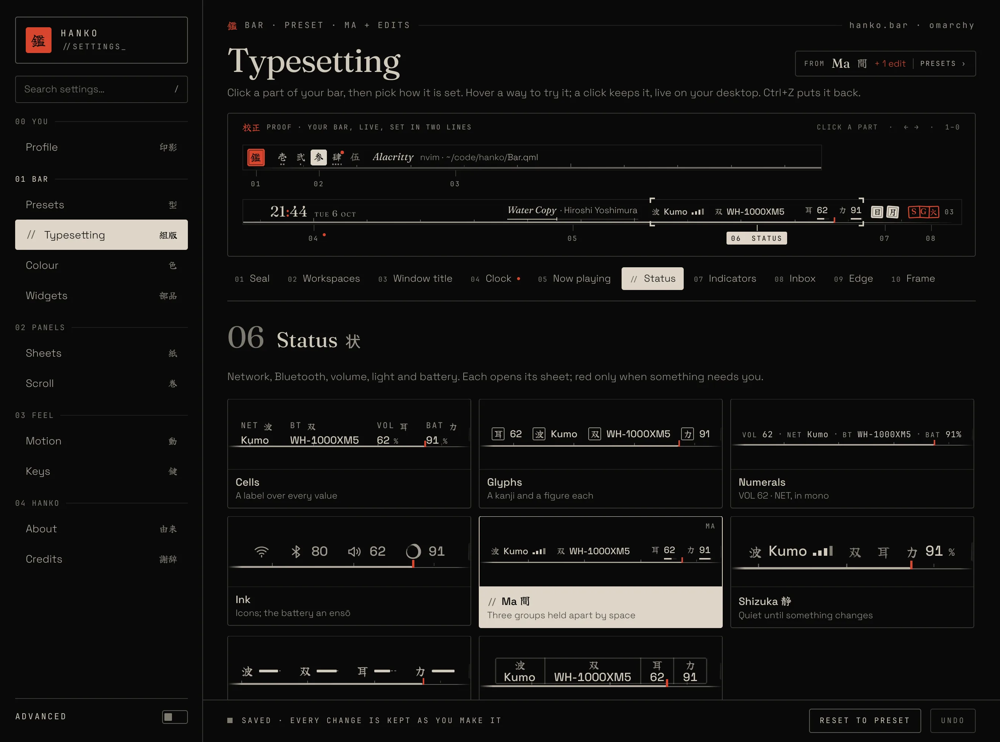
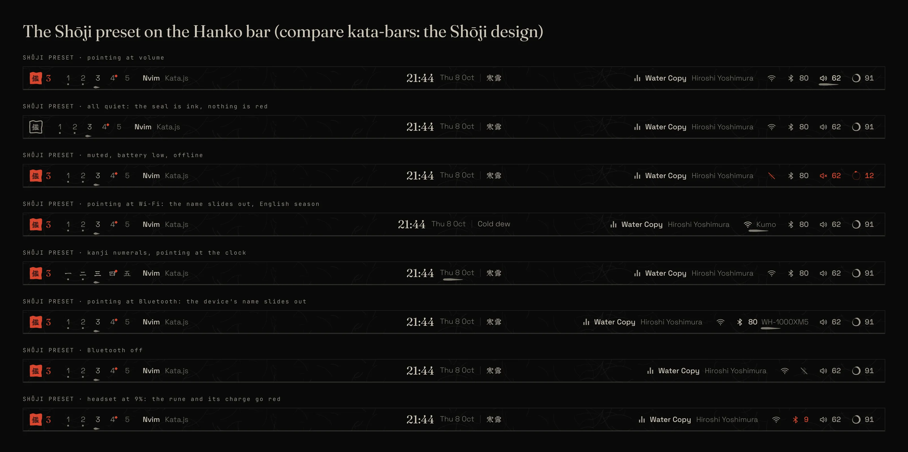

# Hanko 判子

A bar for [Omarchy](https://github.com/omacom/omarchy), printed in your theme's paper and ink.





## What you get

- **Every part is a setting:** 26 settings and 9 presets (Quiet, Islet, Shōji, Kamon 家紋 (the default; it was the Hanko preset), Inkan 印, and the right-side studies Ma, Shizuka, Suji, Inrō). Shōji's bar is part of them: its carved seal, brush desks, season clock, ink status with the ensō battery, washi paper and brush pointer are values you can mix into any bar, with season, numerals and paper grain as switches.
- **Shōji, as part of Hanko:** the Shōji look (washi, brush and the seasons) is the Shōji preset, `hanko style preset shoji`: its bar values, its washi panels as a sheet hand sliding along their rail, each also something you can mix into any other bar. Every change prints live and is kept at once, with Undo (there is no Save button). Settings › Sheets sets how see-through every panel is (30–100%).
- **Hanko, finished by hand:** each sheet is numbered like a page, carries its kanji pressed faintly behind the title, and ends in a colophon strip; groups are underscored, sliders have a capped needle, and the paper casts a soft shadow with printer's crop marks.
- **Left:** a seal, your workspaces and the window title.
- **Centre:** the clock and what's playing.
- **Right:** sound, network, Bluetooth, battery, brightness, notifications, and Omarchy's six indicators as small stamps (icons or kanji, named when on).
- **A calm right side, four ways:** Ma 間 (groups held apart by space), Shizuka 静 (quiet until something changes, like a game HUD that shows health only when you're hit), Suji 筋 (one brush line per reading, its length the level) and Inrō 印籠 (one ruled case of compartments). Each is a `status` value and a preset, and every preset has a live specimen on Settings › Presets 型; the research and the study sheets are in [docs/right-side/](docs/right-side/README.md).
- **Seven hands for every sheet:** each cell's sheet can be a Ledger 帳 (the editorial page), Tanzaku 短冊 (each choice a poem slip hung from a rail, as long as its level), Shōgi 将棋 (each level a piece on a rank of nine squares, choices on the piece stand), Soroban 算盤 (the figures counted in abacus beads), Odoshi 縅 (each level a lame of armour scales laced as far as it goes), Kasumi 霞 (each level a band of gold-leaf mist) or Shōji 障子 (Shōji's washi panels, sliding along a rail under the bar, now on the Hanko bar too, with a Display panel of their own); pick per sheet on Settings › Sheets. The research behind them is in [docs/revision2/sheet-hands.md](docs/revision2/sheet-hands.md).
- **Inkan 印, the seal only:** set `form: inkan` (or `scripts/hanko inkan`) and the bar goes away, leaving one seal in a corner you choose. Its carving is the status: the strokes wear away as the battery falls, a chipped corner is a letter waiting, an outline is do not disturb, a broken rule is offline; hover sets the time and what needs you beside it. Press it, or a key, and the whole shell prints as one sheet, No. 00: the time, your workspaces and window, what's playing and a row for every sheet, each opening that sheet in its own hand. It lifts off when you're done. Per monitor too: a laptop can be all seal beside a full bar. The design is in [docs/shell-concepts/inkan/](docs/shell-concepts/inkan/README.md).
- **Panels:** click any cell to drop its sheet.
- **Letters one by one:** in every hand, click a letter that runs long to read it in full, and put any one away with its × (or Delete): it leaves Omarchy's history for good, not only the bar. The inbox works on every Omarchy channel: stable, rc, edge and dev (whose newer notification daemon keeps its letters differently). With the desk on, the letters run on whichever notification daemon your Omarchy has, so the newer one's snooze and history are kept. Without the desk, on Omarchy's own newer daemon (which can't forget a single letter), a letter put away stays hidden in Hanko until Omarchy's history lets it go.
- **Keyboard first, like Omarchy:** every sheet in every hand takes Omarchy's panel keys. Omarchy's own hotkeys open them (Super+Ctrl+A, W, B, P, D, Super+Ctrl+1–9), the first arrow shows a cursor (four red corner marks), the arrows or H J K L move it, Enter or Space press, Left and Right set a ruler, + and - set the sheet's level, Tab goes to the next sheet and Esc closes it. The tray menus walk the same way. **Bar focus** (`omarchy-shell hanko barFocus`, Super+Ctrl+0 with the binding below) hands the bar itself the keyboard: walk its parts, Enter to click, Menu to right-click a tray app, Up and Down for volume, 1–9 for a workspace, Esc to let go. A sheet opened from there hands the keyboard back when it closes. **The settings window** walks the same way over its rail and page (Tab for the next page, `[` `]` for Typesetting's parts). As on Omarchy's panels, keys and pointer share one cursor: hovering moves it too, so you can start with the mouse and carry on with the keys.
- **A workspace overview:** every workspace laid out as a page with its windows live where they sit. Arrows switch (Enter or Esc leaves you where they took you), a click goes there, dragging moves a window, middle-click closes one. Or pick Ryoku's layout: only the workspaces you use, a + for a new one, and desktops along the top.
- **Your widgets still work:** Omarchy's hotkeys, tray, indicators and third-party bar widgets.
- **Written, not typeset:** every kanji is drawn in a brush face (Yuji Boku, bundled), and your seal is 鑑 by default, or 漢, 観 or 寛 from Settings › Typesetting.
- **Follows your theme,** light or dark, and switches with it live.
- **Settings you read by looking:** every page shows the thing itself: Typesetting is a printer's proof of your bar, Presets a pattern book showing only what would change, Parts a tray of your bar's real parts to set aside, Colour every theme drawn in its own inks, Screens your monitors to scale, Sheets each hand as a picture of the sheet, Motion a timesheet you can play, Keys a keymap. On Typesetting your bar is set large with its parts numbered in the margin; click one, and every way it can be set appears as the real part, drawn with your data. Hover one to try it on the proof, click to keep it, and Ctrl+Z puts it back.
- **A profile plate to show off your desk:** Profile 印影 in the settings window is laid out like a seal registration certificate: your name and your machine's small print, your seal glyph written large in ink and signed with two small seals, and your bar's live readings as a row of stats; EDIT renames it, hides any block and saves it as an image. About 由来 and Credits 謝辞 sit beside it.
- **Safe to try:** if Hanko fails to load, Omarchy puts its own bar back.

## Requirements

- Omarchy with its shell running (`omarchy-shell`)
- `jq` and `rsync` for the CLI; `curl` for the weather
- Noto CJK fonts for the kanji (Omarchy installs them)

## Install

The recommended way is the manual install:

```sh
git clone https://github.com/AyushKr2003/hanko.git
cd hanko
scripts/hanko install
```

- This copies only what the bar needs to `~/.config/omarchy/plugins/hanko.bar`, makes it your bar and restarts the Omarchy shell so it loads.
- It remembers the bar you had, so uninstalling puts that one back.
- **For development:** `scripts/hanko dev` symlinks the checkout instead; run `omarchy-restart-shell` after an edit to load it.
- **Check the install:** `scripts/hanko doctor`.

## Update

```sh
cd hanko && git pull && scripts/hanko install
```

If you installed from the marketplace: `omarchy plugin update hanko.bar`, then `omarchy-restart-shell`. The shell's own plugin reload keeps running the Hanko it already loaded, so an update shows only after a restart.

## Uninstall

```sh
scripts/hanko menu remove   # only if you added the menu entry
scripts/hanko uninstall
```

- This switches back to your previous bar and removes the plugin folder.
- Your style is kept in `~/.config/hanko/`. Delete that folder to remove it too.
- If you installed from the marketplace: `omarchy bar use omarchy.bar`, then `omarchy plugin remove hanko.bar`.

## Use

| Do this | Command |
|---|---|
| Open the settings window | `scripts/hanko settings` |
| Pick a preset | `scripts/hanko style preset Kamon` |
| The seal only (Inkan), or the bar again | `scripts/hanko inkan` (`on`, `off`) |
| Put the seal in another corner | `scripts/hanko style set inkanAt top-left` (or drag it there) |
| Press the seal: print No. 00, or lift it off | `scripts/hanko press` |
| The bar takes the keyboard (again: lets go) | `omarchy-shell hanko barFocus` |
| Change one setting | `scripts/hanko style set clock mono` |
| Change it on one monitor | `scripts/hanko style set --monitor DP-2 height 32` |
| Random look | `scripts/hanko style shuffle` |
| Back to the preset | `scripts/hanko style reset` |
| See the current style | `scripts/hanko style get` |
| Hide or show a part | `scripts/hanko hide tray` / `scripts/hanko show tray` |
| Lay out every workspace (the overview) | `omarchy-shell hanko overview`, or right-click the workspaces |
| Ryoku's overview instead (busy spaces and a +) | `scripts/hanko style set overview dynamic` (`grid`, `dynamic`, `mission`) |
| The live space's windows spread out, a strip of spaces, type to search | `scripts/hanko style set overview mission` |
| Indicator stamps: only what is on, kanji with names | `scripts/hanko style set indicators active` / `scripts/hanko style set indicatorStyle kanjiname` |
| Turn motion off | `scripts/hanko style set motion still` |
| Larger or smaller text (the bar grows with it) | `scripts/hanko style set typeSize large` (`small`, `regular`, `large`) |
| Add Setup › Hanko to the Omarchy menu | `scripts/hanko menu add` |

- Changes show on the bar at once and are saved to `~/.config/hanko/style.json`.
- Every setting and option is listed in [COMPONENTS.md](docs/COMPONENTS.md).
- Parts you can hide include `seal`, `clock`, `volume`, `tray`, `indicator:<name>`, `tray:<app>` and `hosted:<widget id>`.

## Optional extras

**A key for the seal (Inkan).** `hanko press` prints No. 00 from the seal, or from the bar's seal when you use the bar:

```lua
hl.unbind("SUPER + ALT + I")
o.bind("SUPER + ALT + I", "Hanko seal", "omarchy-shell hanko press")
```

**A key for bar focus.** The bar takes the keyboard (Super+Ctrl+0 is free in a stock Omarchy: its panel keys use 1–9):

```lua
hl.unbind("SUPER + CTRL + code:19")
o.bind("SUPER + CTRL + code:19", "Hanko bar focus", "omarchy-shell hanko barFocus")
```

**A key for the overview.** Omarchy's `SUPER + TAB` steps workspaces; to put the overview there instead:

```lua
hl.unbind("SUPER + TAB")
o.bind("SUPER + TAB", "Hanko overview", "omarchy-shell hanko overview")
```

**A blurred desk under the overview.** Ryoku's layout dims the desk; to blur it as well:

```lua
hl.layer_rule({ match = { namespace = "hanko-overview" }, blur = true })
```

**Frosted glass.** The `glass` surface needs a blur rule in `~/.config/hypr/hyprland.lua`:

```lua
hl.layer_rule({ match = { namespace = "hanko-bar" }, blur = true, ignore_alpha = 0.5 })
```

**Windows that match the bar.** `style.lua` gives Hyprland windows the bar's look: 1 px hairline frames in your theme's ink, square corners (7 px with the `inset` surface, whose 8 px gap the windows share), no shadow (set `shadow_style` to `paper` for a short black one), flat mono group tabs and the bar's motion (Iai) (`motion: still` stops window animations too). It reads `colors.toml` and `~/.config/hanko/style.json`, so it follows `omarchy theme set`. Load it last in `~/.config/hypr/looknfeel.lua`:

```lua
pcall(dofile, os.getenv("HOME") .. "/.config/omarchy/plugins/hanko.bar/style.lua")
```

Every Hyprland look and animation Hanko has is in that one file, and nothing loads it for you: Hanko never edits your Hyprland config, so the line is yours to add or take out. (An older `hanko desk on` added a marked `-- hanko desk` line itself; `desk on` or `desk off` now takes that one out.)

The rest of the desk is `hanko desk on` (or the Desk card in Settings › Kaze, or `hanko install --desk`), whichever bar you use; `hanko desk off` gives everything back to Omarchy (Kaze 風, [docs/kaze](docs/kaze/README.md)). The desk stays on across reboots: a post-boot hook runs `hanko desk ensure`, which puts back any part the shell came up without (its log is `~/.local/state/hanko/desk-boot.log`; the Settings switch writes `desk.log` beside it). With the line in looknfeel.lua, windows move on Iai 居合, the five beats the bar moves on: they draw in from the nearest edge with a dead stop and sheathe out more slowly, workspaces roll a short way, nothing pops or springs. `desk on` also installs a small desk plugin (`hanko.desk`): when focus moves, light runs once round the new window's edge, and a window that needs you is framed in red until you go to it. With `motion: still` the sweep doesn't run. `hanko cursor on` puts on a brush-tip cursor in your theme's ink (`hanko cursor off` puts yours back). Sounds are off until `"sound": "quiet"` (or `"on"`) in `~/.config/hanko/kaze.json`. The Hanko theme ships in the repo (`theme/`): `hanko theme install`, then `omarchy theme set hanko`, gives Omarchy the bar's paper, ink and red everywhere, with btop and Neovim in its inks and seven ukiyo-e prints. `hanko tools on` puts btop and Neovim (LazyVim) on the same paper and inks, red only for errors and readings near their limit; `hanko tools off` gives them back to Omarchy's theme. For the terminal there is a prompt, `set -gx STARSHIP_CONFIG ~/.config/omarchy/plugins/hanko.bar/assets/kaze/starship.toml`, and a greeting, `~/.config/omarchy/plugins/hanko.bar/scripts/hanko-greet`. `hanko sumi` toggles Sumi 墨, the screen in ink with only your theme's red kept, notifications held and the bar receding to its rule until you point at it. It also prints your wallpaper again in the theme's paper and ink (a clone of Omarchy's background; `{"wallpaper": "original"}` in `~/.config/hanko/kaze.json` turns that off). All of these are switches on the Kaze 風 page of `hanko settings` (Wind can also be Virtual: your own speed, 0–60 km/h, and side, for when the real air is still; in any felt wind the grass waves downwind and, when it's strong, gusts now and then; `"wind": "virtual", "windSpeed": 24, "windFrom": "west"` in kaze.json) (the desk, motion, the print, grass, gusts, wind, sound and Sumi, each with a small picture; Ctrl+Z undoes), and `hanko doctor` checks that each part of the desk is installed and answering.

After a style change in Hanko, run `hyprctl reload` to bring the windows along. Set `shadow_style` near the top of the file to `print` (a hard black offset), `seal` (the same in seal red) or `none` (hairlines only).

## Troubleshooting

- **Bar didn't change:** run `scripts/hanko doctor`.
- **QML errors:** check `journalctl --user -f`.
- **A setting was ignored:** `omarchy-shell hanko warnings` lists what `style.json` got wrong.

## Docs

- [Every component and combination](docs/COMPONENTS.md)
- [Roadmap](docs/ROADMAP.md)
- [Kaze 風: the whole desk, research, mockups and plan](docs/kaze/README.md)
- [Handoff: the full state of the build](docs/HANDOFF.md)
- [Changelog](CHANGELOG.md)
- Earlier design directions are on the `docs` branch.

## Credits

- Design language inspired by [Ryoku](https://github.com/Ryoku-dev/ryoku)'s settings app and [ryoku.dev](https://ryoku.dev). No Ryoku code is used.
- Bundled fonts: Fraunces and Space Grotesk, under the SIL Open Font License (`assets/fonts/`).

## License

- Hanko is [MIT](LICENSE).
- The bundled fonts keep their own SIL Open Font License (`assets/fonts/*-OFL.txt`).
