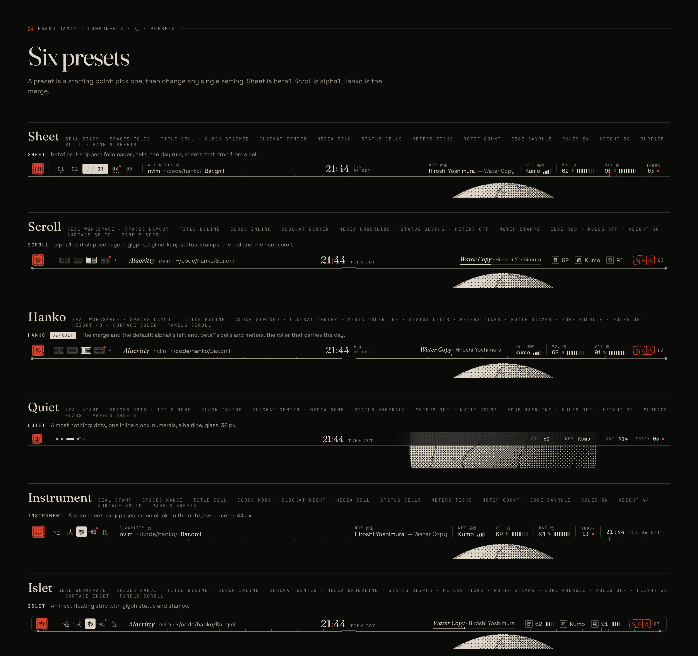

# Hanko

判子 · a configurable bar for [Omarchy](https://github.com/omacom/omarchy), printed in your theme's paper and ink.

**Status: early plugin (phase 5 of 10).** Typeset merges the Sheet and Scroll directions into one bar where every part is a setting: 15 settings, 6 presets, 2,985,984 combinations. The plugin (`hanko.bar`, a full-bar Omarchy plugin) is being built phase by phase; see the [roadmap](docs/ROADMAP.md). Right now it draws the seal, your workspaces, the window title, the clock (stacked, inline or mono, following your 12- or 24-hour setting), what is playing, your sound, network, battery and brightness, and your notifications on your theme's paper, edged with a hairline, a day rule, a scroll rod or the rod carrying the day, solid, glass or floating inset, and reads every setting from `~/.config/hanko/style.json`.

## Try it

```sh
git clone -b dev https://github.com/AyushKr2003/hanko.git
cd hanko
scripts/hanko install      # or `scripts/hanko dev` to symlink the checkout
scripts/hanko style preset Sheet
scripts/hanko uninstall    # puts your previous bar back
```

Hanko only replaces the bar. If it ever fails to load, Omarchy falls back to its own bar on its own.

**Glass needs a blur rule.** The `glass` surface (and Omarchy's bar transparency toggle, which Hanko shows as glass) draws the paper at 74 %. Omarchy doesn't blur its own bar, so Hanko doesn't change your Hyprland config either; for the frosted look, add this to `~/.config/hypr/hyprland.lua`:

```lua
hl.layer_rule({ match = { namespace = "hanko-bar" }, blur = true, ignore_alpha = 0.5 })
```




- **[Every component and combination](docs/COMPONENTS.md)**
- [Handoff: the full state of the build](docs/HANDOFF.md)
- [Design overview](docs/DESIGN.md)
- [Twelve random combinations](docs/mockups/typeset/04-shuffle.png)
- [Presets across themes](docs/mockups/typeset/05-presets-x-themes.png)
- [Hanko preset with the scroll open](docs/mockups/typeset/20-desk-hanko-scroll.png)
- [Sheet preset with a sheet open](docs/mockups/typeset/21-desk-sheet-sound.png)
- [All Typeset mockups](docs/mockups/typeset/)

Earlier directions: [Sheet](docs/history/sheet-DESIGN.md) and [Scroll](docs/history/scroll-DESIGN.md).

Design language inspired by [Ryoku](https://github.com/Ryoku-dev/ryoku)'s settings app and [ryoku.dev](https://ryoku.dev). The wallpaper plates in the mockups are procedural and made for them.
