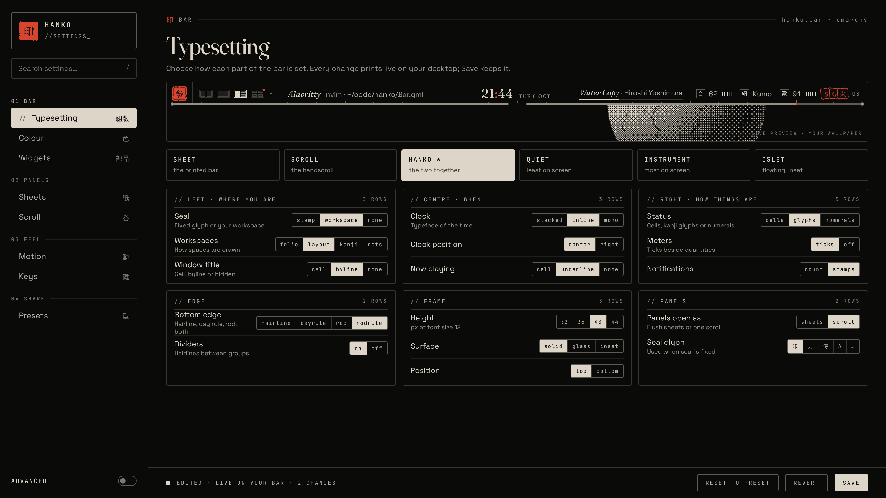
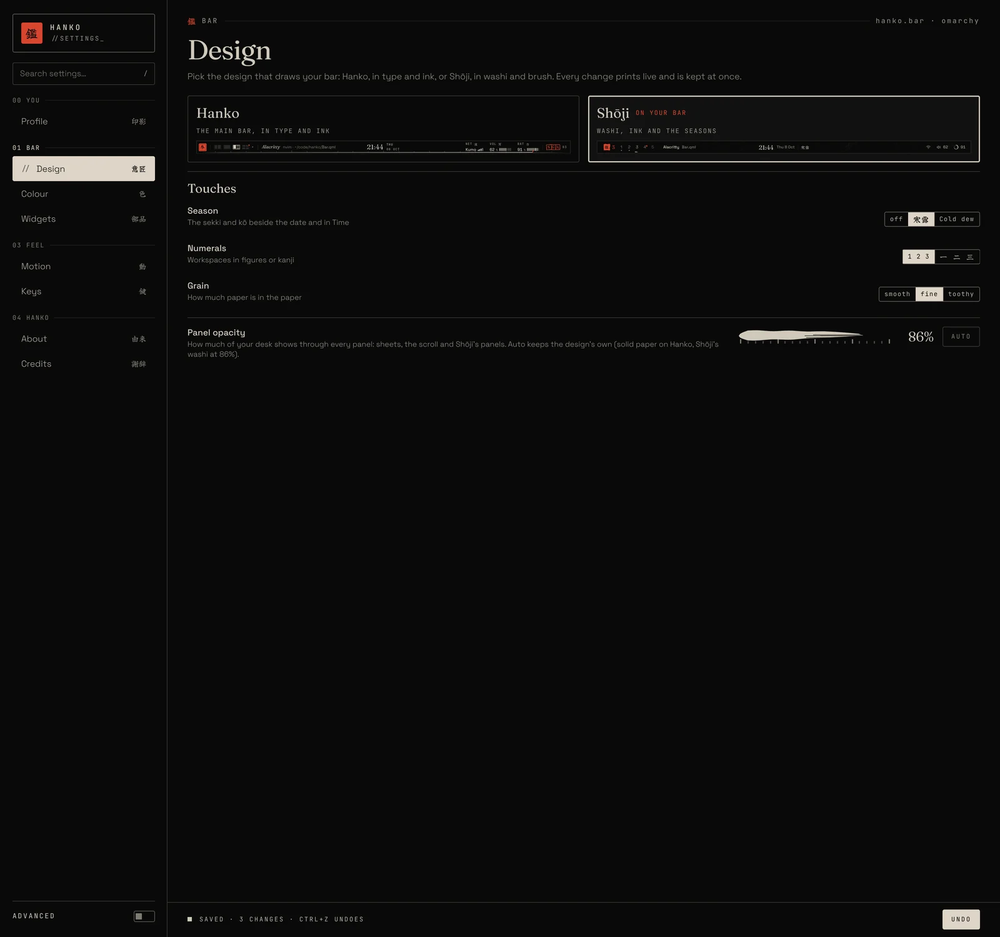

# Hanko 判子

A bar for [Omarchy](https://github.com/omacom/omarchy), printed in your theme's paper and ink.





## What you get

- **Every part is a setting:** 22 settings and 6 presets (Sheet, Scroll, Hanko, Quiet, Instrument, Islet).
- **Two designs** (Kata 型, `docs/kata/`): pick Hanko or Shōji (washi, brush and the seasons) on Settings › Design 意匠, with three touches for Shōji (season, numerals, grain); every pick prints live and is kept at once, with Undo (there is no Save button). A slider there sets how see-through every panel is (30–100%). From a terminal, `hanko design shoji` switches the bar to Shōji, `hanko touch season english` flips a touch, and `hanko design hanko` brings today's look back (still the default). Shōji has a Bluetooth cell and opens its own panels (Time, Sound, Network, Bluetooth, Power, Letters), letters, overview and hold-to-confirm buttons.
- **Hanko, finished by hand:** each sheet is numbered like a page, carries its kanji pressed faintly behind the title, and ends in a colophon strip; groups are underscored, sliders have a capped needle, and the paper casts a soft shadow with printer's crop marks.
- **Left:** a seal, your workspaces and the window title.
- **Centre:** the clock and what's playing.
- **Right:** sound, network, Bluetooth, battery, brightness, notifications, and Omarchy's six indicators as small stamps (icons or kanji, named when on).
- **Six hands for every sheet:** each cell's sheet can be a Ledger 帳 (the editorial page), Tanzaku 短冊 (each choice a poem slip hung from a rail, as long as its level), Shōgi 将棋 (each level a piece on a rank of nine squares, choices on the piece stand), Soroban 算盤 (the figures counted in abacus beads), Odoshi 縅 (each level a lame of armour scales laced as far as it goes) or Kasumi 霞 (each level a band of gold-leaf mist); pick per sheet on Settings › Sheets. The research behind them is in [docs/revision2/sheet-hands.md](docs/revision2/sheet-hands.md).
- **Panels:** click any cell to drop a sheet, or set `panels: scroll` to unroll every panel as one handscroll. The scroll opens on today's weather, you pick from nine dividers between its sections, and from nine leaves after Inbox (almanac, machine, session, themes, tools, focus timer, notes and more).
- **A workspace overview:** every workspace laid out as a page with its windows live where they sit. Arrows switch, a click goes there, dragging moves a window, middle-click closes one. Or pick Ryoku's layout: only the workspaces you use, a + for a new one, and desktops along the top.
- **Your widgets still work:** Omarchy's hotkeys, tray, indicators and third-party bar widgets.
- **Written, not typeset:** every kanji is drawn in a brush face (Yuji Boku, bundled), and your seal is 鑑 by default, or 漢, 観 or 寛 from Settings › Typesetting.
- **Follows your theme,** light or dark, and switches with it live.
- **A profile plate to show off your desk:** Profile 印影 in the settings window is laid out like a seal registration certificate: your name and your machine's small print, your seal glyph written large in ink and signed with two small seals, and your bar's live readings as a row of stats; EDIT renames it, hides any block and saves it as an image. About 由来 and Credits 謝辞 sit beside it.
- **Safe to try:** if Hanko fails to load, Omarchy puts its own bar back.

## Requirements

- Omarchy with its shell running (`omarchy-shell`)
- `jq` and `rsync` for the CLI; `curl` for the weather
- Noto CJK fonts for the kanji (Omarchy installs them)

## Install

```sh
git clone -b dev https://github.com/AyushKr2003/hanko.git
cd hanko
scripts/hanko install
```

- This copies Hanko to `~/.config/omarchy/plugins/hanko.bar` and makes it your bar.
- It remembers the bar you had, so uninstalling puts that one back.
- **For development:** `scripts/hanko dev` symlinks the checkout instead, and saving a file reloads the bar.
- **Check the install:** `scripts/hanko doctor`.

## Update

```sh
cd hanko && git pull && scripts/hanko install
```

## Uninstall

```sh
scripts/hanko menu remove   # only if you added the menu entry
scripts/hanko uninstall
```

- This switches back to your previous bar and removes the plugin folder.
- Your style is kept in `~/.config/hanko/`. Delete that folder to remove it too.

## Use

| Do this | Command |
|---|---|
| Open the settings window | `scripts/hanko settings` |
| Pick a preset | `scripts/hanko style preset Sheet` |
| Change one setting | `scripts/hanko style set clock mono` |
| Change it on one monitor | `scripts/hanko style set --monitor DP-2 height 32` |
| Random look | `scripts/hanko style shuffle` |
| Back to the preset | `scripts/hanko style reset` |
| See the current style | `scripts/hanko style get` |
| Hide or show a part | `scripts/hanko hide tray` / `scripts/hanko show tray` |
| Unroll the scroll | `scripts/hanko scroll` |
| Lay out every workspace (the overview) | `omarchy-shell hanko overview`, or right-click the workspaces |
| Ryoku's overview instead (busy spaces and a +) | `scripts/hanko style set overview dynamic` (`grid`, `dynamic`) |
| Pick the scroll's dividers | `scripts/hanko style set interlude kotoba` |
| Pick the leaf after Inbox | `scripts/hanko style set endleaf shimai` |
| Bare scroll edges, or the paper curling under | `scripts/hanko style set sides bare` (`bare`, `curl`) |
| The scroll's tabs on top, position bar at the foot, both or neither | `scripts/hanko style set guides tabs` (`both`, `tabs`, `foot`, `none`) |
| Indicator stamps: only what is on, kanji with names | `scripts/hanko style set indicators active` / `scripts/hanko style set indicatorStyle kanjiname` |
| Turn motion off | `scripts/hanko style set motion still` |
| Larger or smaller text (the bar grows with it) | `scripts/hanko style set typeSize large` (`small`, `regular`, `large`) |
| Add Setup › Hanko to the Omarchy menu | `scripts/hanko menu add` |

- Changes show on the bar at once and are saved to `~/.config/hanko/style.json`.
- Every setting and option is listed in [COMPONENTS.md](docs/COMPONENTS.md).
- Parts you can hide include `seal`, `clock`, `volume`, `weather`, `tray`, `indicator:<name>`, `tray:<app>` and `hosted:<widget id>`.

## Optional extras

**A key for the scroll.** Add this to `~/.config/hypr/bindings.lua`:

```lua
o.bind("SUPER + CTRL + U", "Hanko scroll", "omarchy-shell hanko scroll")
```

**A key for the overview.** Omarchy's `SUPER + TAB` steps workspaces; to put the overview there instead:

```lua
hl.unbind("SUPER + TAB")
o.bind("SUPER + TAB", "Hanko overview", "omarchy-shell hanko overview")
```

**A blurred desk under the overview.** Ryoku's layout dims the desk; to blur it as well:

```lua
hl.layer_rule({ match = { namespace = "hanko-overview" }, blur = true })
```

**Frosted glass.** The `glass` surface needs a blur rule in `~/.config/hypr/hyprland.lua`:

```lua
hl.layer_rule({ match = { namespace = "hanko-bar" }, blur = true, ignore_alpha = 0.5 })
```

**Windows that match the bar.** `style.lua` gives Hyprland windows the bar's look: 1 px hairline frames in your theme's ink, square corners (7 px with the `inset` surface, whose 8 px gap the windows share), a short black shadow down and right, darker under the focused window, flat mono group tabs and the bar's motion timings (`motion: still` stops window animations too). It reads `colors.toml` and `~/.config/hanko/style.json`, so it follows `omarchy theme set`. Load it last in `~/.config/hypr/looknfeel.lua`:

```lua
pcall(dofile, os.getenv("HOME") .. "/.config/omarchy/plugins/hanko.bar/style.lua")
```

After a style change in Hanko, run `hyprctl reload` to bring the windows along. Set `shadow_style` near the top of the file to `print` (a hard black offset), `seal` (the same in seal red) or `none` (hairlines only).

## Troubleshooting

- **Bar didn't change:** run `scripts/hanko doctor`.
- **QML errors:** check `journalctl --user -f`.
- **A setting was ignored:** `omarchy-shell hanko warnings` lists what `style.json` got wrong.
- **No weather on the scroll:** it needs `curl` and a network connection, and only shows on screens about 1600 px wide or more.

## Docs

- [Every component and combination](docs/COMPONENTS.md)
- [Design overview](docs/DESIGN.md)
- [Roadmap](docs/ROADMAP.md)
- [Handoff: the full state of the build](docs/HANDOFF.md)
- [Changelog](CHANGELOG.md)
- Earlier design directions are on the `docs` branch.

## Credits

- Design language inspired by [Ryoku](https://github.com/Ryoku-dev/ryoku)'s settings app and [ryoku.dev](https://ryoku.dev). No Ryoku code is used.
- Bundled fonts: Fraunces and Space Grotesk, under the SIL Open Font License (`assets/fonts/`).

## License

- Hanko is [MIT](LICENSE).
- The bundled fonts keep their own SIL Open Font License (`assets/fonts/*-OFL.txt`).
