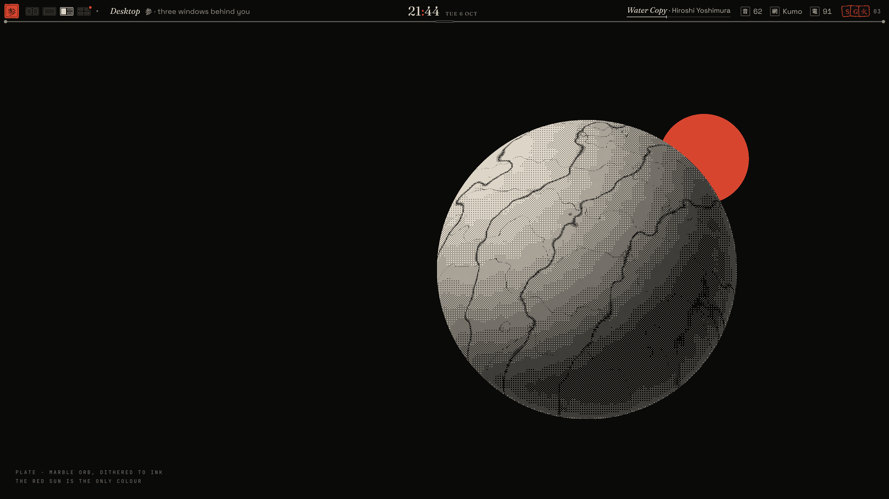
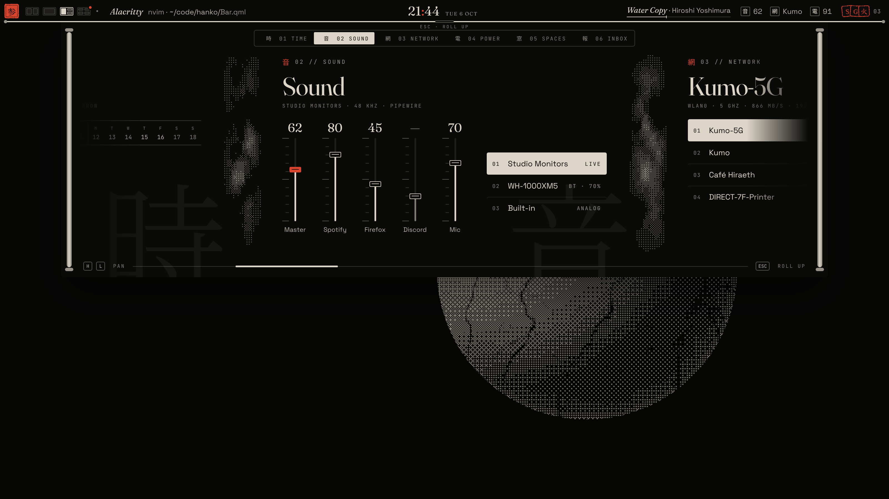

# Hanko

判子 · a calm bar for [Omarchy](https://github.com/omacom/omarchy) that unrolls into a handscroll.

**Status: alpha1, design only.** This branch replaces the beta1 direction. There is no plugin code yet; it holds the design and the mockups. The plugin (`hanko.bar`, a full-bar Omarchy plugin) comes next.

- [Design rationale](docs/DESIGN.md)
- [The bar, at rest and touched](docs/mockups/02-bar.png)
- [Spaces and Inbox on a light theme](docs/mockups/04-scroll-spaces-light.png)
- [Motion](docs/mockups/05-motion.png)
- [Themes](docs/mockups/06-themes.png)

Design language inspired by [Ryoku](https://github.com/Ryoku-dev/ryoku)'s settings app and [ryoku.dev](https://ryoku.dev). The wallpaper plates in the mockups are procedural and made for them.
