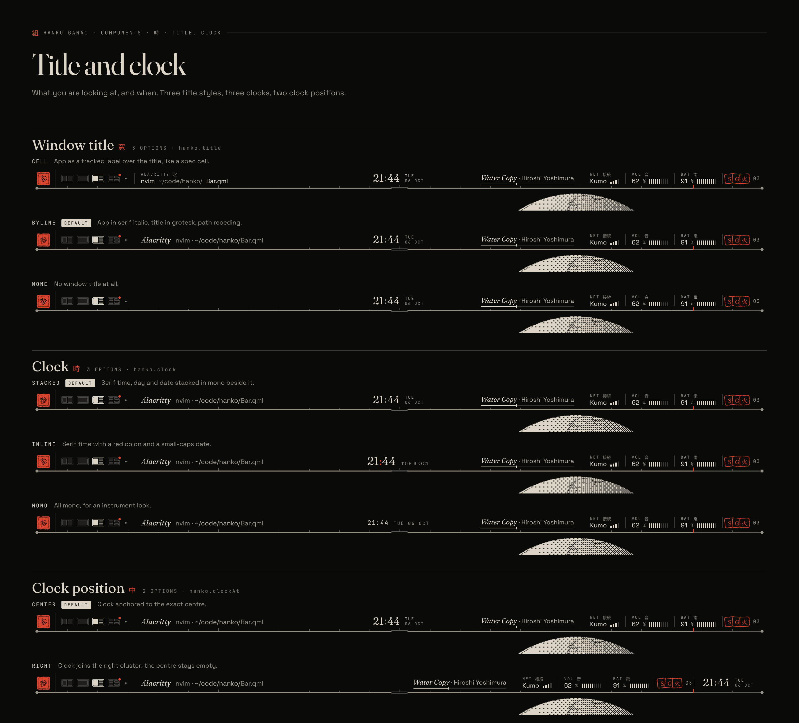
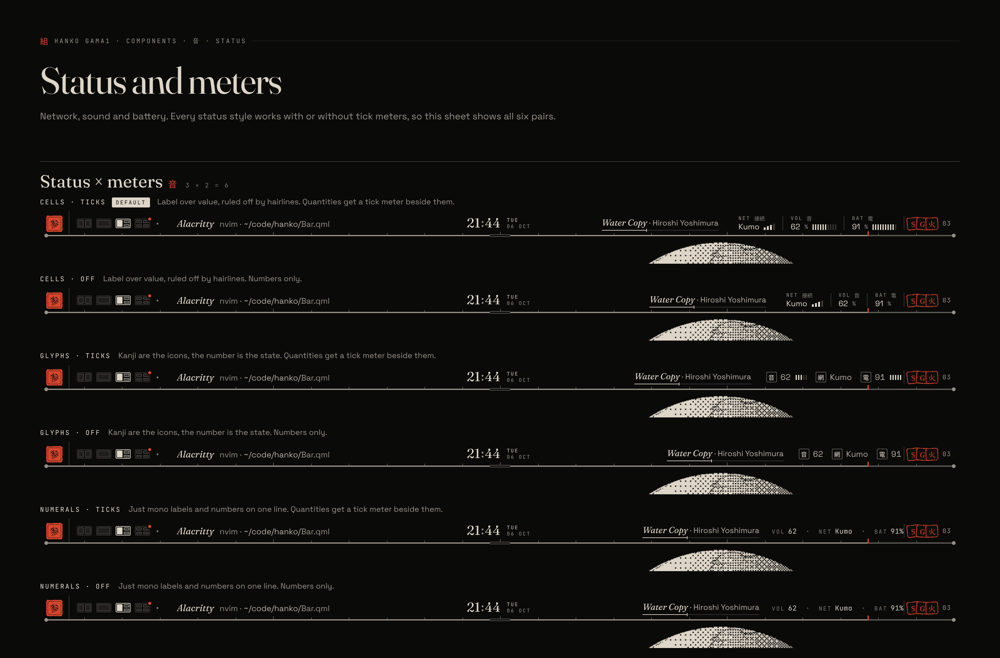
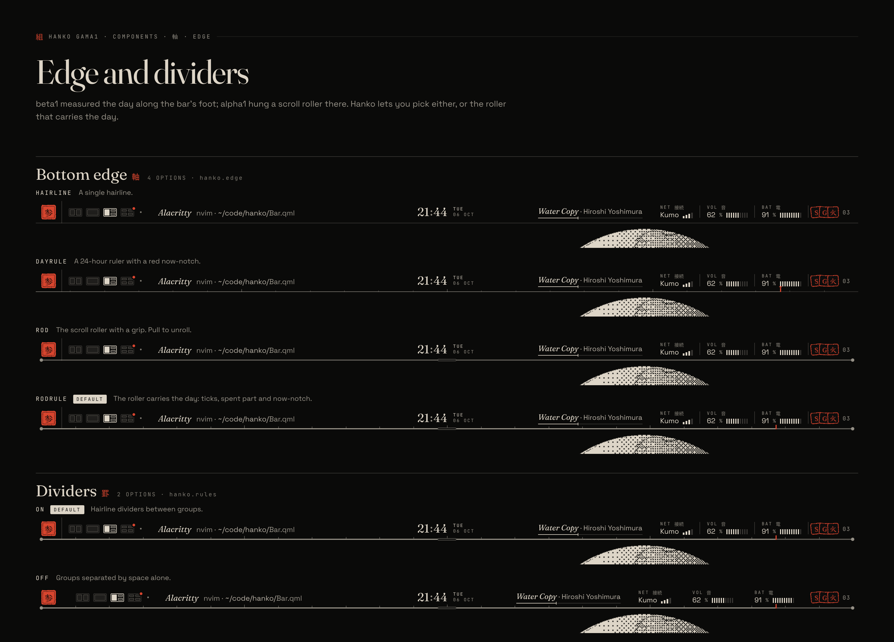
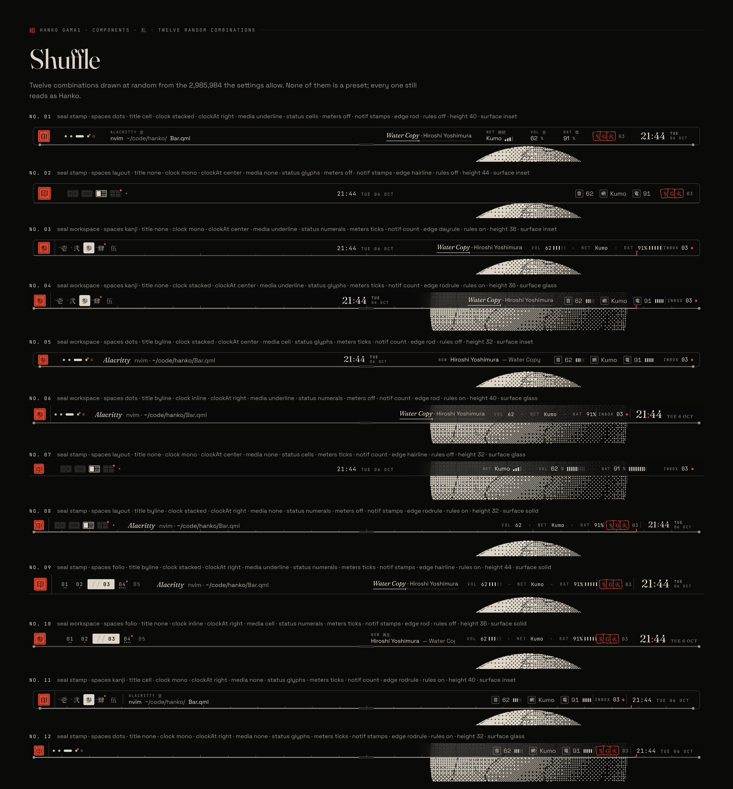

# Hanko gama1: every component, every combination

gama1 merges the two earlier directions into one bar. beta1 (the printed running head) and alpha1 (the calm bar that unrolls into a handscroll) are no longer rival designs. Each of their parts is now an option on one setting, chosen on Hanko's own settings page.

- **Sheet** is beta1 as it shipped.
- **Scroll** is alpha1 as it shipped.
- **Hanko** is the merge, and the default.

Sixteen settings give **5,971,968** distinct bars before you even change the seal glyph or the theme. Every one of them still reads as Hanko, because every option is drawn from the same three things: paper, four inks and one seal red.


## Contents

1. [The rules every option keeps](#1-the-rules-every-option-keeps)
2. [The sixteen settings](#2-the-sixteen-settings)
3. [How options interact](#3-how-options-interact)
4. [Presets](#4-presets)
5. [Counting the combinations](#5-counting-the-combinations)
6. [The settings page](#6-the-settings-page)
7. [Config file](#7-config-file)
8. [Sheets](#8-sheets)

---

## 1. The rules every option keeps

These rules are what let any combination look designed rather than assembled.

| Rule | Why it matters |
|---|---|
| **One paper, four inks, one red.** All colour comes from Omarchy's `colors.toml`. Paper is `background`; ink is `foreground` stepped to 12, 9, 6.2 and 4.6 : 1; seal is `red`. | No option can introduce a colour, so no combination can clash. |
| **Red means "you" or "now".** The seal, the now-notch, an urgent workspace, a muted master fader, an unread dot. Nothing else is red. | Red stays a signal whatever you turn on. |
| **Emphasis is inversion.** The selected thing becomes a solid ink plate (folio page, kanji page, index tab, settings segment). | Every option highlights in the same way. |
| **Three typefaces with fixed jobs.** Fraunces for time, titles and bylines; Space Grotesk for values; your Omarchy mono for labels; Noto JP for kanji. | Swapping a clock style changes the face, never the system. |
| **Hairlines, not shadows.** Dividers, frames and the edge are 1 px ink lines. | Glass and inset surfaces still look printed. |
| **One baseline.** Every zone sits on the same text baseline at every height. | Mixing cells, glyphs and numerals never wobbles. |

---

## 2. The sixteen settings

Each setting has a key (used in the config file), its options, the default (from the Hanko preset), and where it came from. **B** = beta1, **A** = alpha1, **G** = new in gama1.

### Left: where you are


#### Seal `seal` 印

| Option | What it does | From |
|---|---|---|
| `stamp` | A fixed glyph (印 by default; any character). Click for the Omarchy menu, right-click for a terminal. | B |
| **`workspace`** (default) | The seal shows the active workspace as a kanji numeral (壱 弐 参 …). Scroll on it to walk workspaces. | A |
| `none` | No seal. The bar opens with the workspaces. | G |

The glyph used by `stamp` is a separate free-text setting, `sealGlyph` (印 力 侍 A …). It is not counted in the combinations below.

#### Workspaces `spaces` 頁

| Option | What it does | From |
|---|---|---|
| `folio` | Page numbers `01 02 // 03 04`. The live page inverts with a `//` lead; dots under a number count its windows; a red dot marks urgent. | B |
| **`layout`** (default) | Each workspace drawn as its real tiling in hairlines. The live one is outlined and its focused window filled. Hover opens it to show window names. | A |
| `kanji` | Kanji numerals 壱 弐 参 with window dots; the live one inverts. | G |
| `dots` | The quietest: one dot per workspace, the live one a short bar, urgent a red dot, empty an open ring. | G |

#### Window title `title` 窓



| Option | What it does | From |
|---|---|---|
| `cell` | The app as a tracked mono label (`ALACRITTY 窓`) over the title. | B |
| **`byline`** (default) | The app in serif italic like an author's byline; title in grotesk; path parts recede. | A |
| `none` | No title. | G |

### Centre: when

#### Clock `clock` 時

| Option | What it does | From |
|---|---|---|
| **`stacked`** (default) | Serif time, with the day and date stacked in small mono beside it. | B |
| `inline` | Serif time with a red colon and a small-caps date on the same line. | A |
| `mono` | All mono, for an instrument look. | G |

#### Clock position `clockAt` 中

| Option | What it does | From |
|---|---|---|
| **`center`** (default) | Anchored to the exact screen centre. | B, A |
| `right` | Joins the end of the right cluster, after a divider; the centre stays empty. | G |

#### Now playing `media` 再生

| Option | What it does | From |
|---|---|---|
| `cell` | `NOW 再生` label over artist and song. | B |
| **`underline`** (default) | Song in serif italic; its underline is the progress bar. | A |
| `none` | Hidden. | G |

### Right: how things are

#### Status `status` 音



| Option | What it does | From |
|---|---|---|
| **`cells`** (default) | `NET 接続 / VOL 音 / BAT 電` label-over-value cells ruled off by hairlines. | B |
| `glyphs` | A boxed kanji is the icon and the number is the state. Solid red when it needs you; dashed when off. | A |
| `numerals` | Mono labels and numbers on one line (`VOL 62 · NET Kumo · BAT 91%`). | G |

#### Meters `meters` 目盛

| Option | What it does | From |
|---|---|---|
| **`ticks`** (default) | Volume, battery and brightness get a ten-tick ruler beside the number; Wi-Fi gets four signal bars. | B |
| `off` | Numbers only. | A |

All six status × meters pairs are drawn on sheet 12.

#### Notifications `notif` 報


| Option | What it does | From |
|---|---|---|
| `count` | `INBOX 03` with one red dot. | B |
| **`stamps`** (default) | Each notification is a small stamped seal of its app's initial, slightly askew, newest on top. Hover fans them out. | A |

#### Bluetooth `bluetooth` 藍

| Option | What it does | From |
|---|---|---|
| **`on`** (default) | A `BT 藍` cell after the network cell: the connected device's name (`+1` for each more) with its battery as the meter, or `On` / `Off`. Click opens the Bluetooth panel; middle- or right-click turns Bluetooth on or off. Machines without an adapter never show it. | G |
| `off` | No Bluetooth cell. The panel is still in the scroll and on Omarchy's hotkey. | G |

Added after the gama1 sheets were drawn, in the same grammar as the other status cells.

### Edge

#### Bottom edge `edge` 軸



| Option | What it does | From |
|---|---|---|
| `hairline` | A single hairline. | B |
| `dayrule` | A 24-hour ruler: hour ticks, longer every six hours, the spent part of the day brighter, a red now-notch. | B |
| `rod` | The scroll's roller with end caps and a centre grip. Hover raises the grip; drag down to unroll. | A |
| **`rodrule`** (default) | The roller carries the day: rod, ticks, spent part and now-notch together. | G |

#### Dividers `rules` 罫

| Option | What it does | From |
|---|---|---|
| **`on`** (default) | Hairline dividers between groups. | B |
| `off` | Groups separated by space alone. | A |

### Frame


#### Height `height` 高

| Option | What it does |
|---|---|
| `32` | Compact. Two-line cells collapse to one line (see §3). |
| `36` | Regular (beta1's height). |
| **`40`** (default) | Roomy (alpha1's height). |
| `44` | Tall, for large or high-DPI screens. |

#### Surface `surface` 面

| Option | What it does |
|---|---|
| **`solid`** (default) | Opaque paper. |
| `glass` | Paper at 74 % over a background blur. The ink ramp does not change, so contrast holds. |
| `inset` | Floats 8 px off the screen edges with a hairline frame and 3 px corners. |

#### Position `position` 位

| Option | What it does |
|---|---|
| **`top`** (default) | Top edge. |
| `bottom` | Bottom edge. Edge details move to the bar's top side (see §3). |

Position follows Omarchy's own `bar.position` when you have not set it in Hanko.

### Panels

#### Panels open as `panels` 紙/巻

| Option | What it does | From |
|---|---|---|
| `sheets` | Clicking a cell inverts it and a flush sheet drops from it, joined to the bar: a mini settings page with eyebrow, serif title, `//` groups and an action strip. | B |
| **`scroll`** (default) | Every panel lives on one handscroll that unrolls from the bar, between two rollers, with an index plate and dithered interludes. Pan with `H` `L`. | A |

Sheets 20–25 show both on full desktops.

The panels are Time 時, Sound 音, Network 網, Bluetooth 藍, Power 電, Display 明 and Inbox 報 (as sheets), and the scroll adds Spaces 窓 between Display and Inbox: eight sections. Display is the LUM cell's panel (and Omarchy's `omarchy.monitor`, `Super+Ctrl+D`): the chosen monitor's brightness on a ruler, every monitor with its mode and scale, and night light. It was added after the gama1 sheets were drawn, in the same grammar. So was Bluetooth (the BT cell's panel and Omarchy's `omarchy.bluetooth`): what is connected as the title, then connected, known and nearby devices (the adapter scans only while the panel is open); a click disconnects, connects or pairs through `omarchy-bluetooth-device`, and the foot turns it on or off through `omarchy-bluetooth-power`.

---

## 3. How options interact

Most settings are independent. These are the places where one setting changes how another is drawn. None of them forbid a combination; they adapt it.

| When | Then |
|---|---|
| `height: 32` | `cells` status and `cell` title/media collapse from label-over-value to one line (label then value). `stacked` clock puts the date beside the time instead of stacking. Seal shrinks to 22 px. |
| `status: numerals` + `meters: ticks` | A short five-tick ruler follows each quantity inline. |
| `status: glyphs` + `meters: ticks` | Four-tick ruler after the number; network keeps its name, no bars. |
| `clockAt: right` | The clock moves after notifications with a divider (if `rules: on`). The centre zone is left empty on purpose, so `media` stays in the right cluster. |
| `edge: dayrule` or `rodrule` + `clockAt: right` | The now-notch still sits on the ruler at the real hour; it no longer lines up under the clock, and that is fine. |
| `position: bottom` | `dayrule`, `rod` and `rodrule` draw along the bar's **top** side. A `scroll` unrolls **upward** and the index plate moves to the bottom; `sheets` rise instead of drop. |
| `surface: inset` | The edge (rod, rule) runs inside the frame, 10 px from each end, so the end caps don't touch the frame. |
| `surface: glass` | Stamps, the seal and inverted plates stay fully opaque; only the paper goes translucent. |
| `seal: workspace` + `spaces: kanji` | The active kanji appears twice (seal and inverted page). This is intended: the seal is a mark, the page is a control. |
| `seal: none` | The left zone starts at 14 px padding; the first divider is dropped. |
| `title: none` + `media: none` | The bar collapses to identity, clock and status: the Quiet preset. |
| `panels: sheets` + `edge: rod` | The rod no longer unrolls anything; dragging it opens the sheet for whatever cell is under the pointer, and `Super+Space` opens Time. |
| `panels: scroll` + no rod edge | `Super+Space` or a click on any status, clock or stamp unrolls the scroll; hovering the bottom edge shows a thin pull tab. |

---

## 4. Presets


A preset sets all sixteen settings at once. Change any setting afterwards and the settings page shows `PRESET · HANKO + EDITS`; **Reset to preset** puts it back.

| Setting | Sheet | Scroll | **Hanko** | Quiet | Instrument | Islet |
|---|---|---|---|---|---|---|
| seal | stamp | workspace | workspace | stamp | stamp | workspace |
| spaces | folio | layout | layout | dots | kanji | kanji |
| title | cell | byline | byline | none | cell | byline |
| clock | stacked | inline | stacked | inline | mono | inline |
| clockAt | center | center | center | center | right | center |
| media | cell | underline | underline | none | cell | underline |
| status | cells | glyphs | cells | numerals | cells | glyphs |
| meters | ticks | off | ticks | off | ticks | ticks |
| notif | count | stamps | stamps | count | count | stamps |
| bluetooth | on | on | on | off | on | on |
| edge | dayrule | rod | rodrule | hairline | dayrule | rodrule |
| rules | on | off | on | off | on | off |
| height | 36 | 40 | 40 | 32 | 44 | 36 |
| surface | solid | solid | solid | glass | solid | inset |
| position | top | top | top | top | top | top |
| panels | sheets | scroll | scroll | sheets | sheets | scroll |

- **Sheet**: beta1 exactly. A spec table across the top of the page.
- **Scroll**: alpha1 exactly. Calm type and a handscroll underneath.
- **Hanko**: the merge. alpha1's left end and panels, beta1's cells and meters, and the roller that carries the day.
- **Quiet**: the least on screen. Dots, an inline clock, numerals, a hairline, on glass.
- **Instrument**: the most on screen. Kanji pages, a mono clock on the right, every meter, 44 px.
- **Islet**: a floating inset strip with kanji status and stamps.


---

## 5. Counting the combinations

| Setting | Options |
|---|---|
| seal | 3 |
| spaces | 4 |
| title | 3 |
| clock | 3 |
| clockAt | 2 |
| media | 3 |
| status | 3 |
| meters | 2 |
| notif | 2 |
| bluetooth | 2 |
| edge | 4 |
| rules | 2 |
| height | 4 |
| surface | 3 |
| position | 2 |
| panels | 2 |

3 × 4 × 3 × 3 × 2 × 3 × 3 × 2 × 2 × 2 × 4 × 2 × 4 × 3 × 2 × 2 = **5,971,968** bars.

That figure is before the seal glyph (any character) and the theme (every Omarchy theme, light or dark). The bar on screen alone, ignoring position and panels, is 1,492,992 combinations.



Sheet 04 draws twelve of them at random with a fixed seed. None is a preset. The settings page will have a **Shuffle** button that does the same, for discovering combinations you would not have picked.

---

## 6. The settings page


Hanko's settings open as their own window in the Ryoku Hub grammar: a numbered rail on the left, a page on the right, an action bar at the foot.

**Rail**

| Group | Pages |
|---|---|
| `01 BAR` | Typesetting 組版 · Colour 色 · Widgets 部品 |
| `02 PANELS` | Sheets 紙 · Scroll 巻 |
| `03 FEEL` | Motion 動 · Keys 鍵 |
| `04 SHARE` | Presets 型 |

There is a search field at the top and an **Advanced** switch at the foot (which shows `sealGlyph`, per-monitor overrides and raw JSON). Per-monitor overrides are set there too: pick a monitor, and every setting is listed with the value that monitor gets; a red tick marks one it sets for itself, and picking what the other screens get drops the override.

**Widgets 部品** shows or hides anything the bar can show, each row `shown | hidden`, in cards: *Left* (seal, workspaces, window title), *Centre* (clock, now playing), *Right · readings* (network, Bluetooth, volume, brightness, battery, notifications), *Marks · Hanko's own* (each indicator, the keyboard layout, the microphone, the tray, as your Omarchy layout has them), *Tray apps* (each app in the tray now), *Widgets · from your Omarchy bar* (every hosted widget, marked Omarchy or third-party) and *Edge*. A part its own setting leaves out (`seal: none`, `title: none`, `media: none`, `bluetooth: off`) reads hidden, and showing it sets it back to the preset's way. Show all puts every hidden part back. Hiding is for this bar only: the widget stays in Omarchy's layout. From a terminal: `hanko hide <part>`, `hanko show <part>`, or `hanko style set show:<part> hidden`.

**Motion 動** holds one switch outside the sixteen settings, `motion`: `paper` (default) moves like alpha1's motion sheet, `still` cuts every transition to its end frame. Omarchy's own animation switch, off, makes Hanko still too. The page lists every timing.

**Typesetting 組版**, the page drawn on sheets 01 and 02, holds every setting in this document:

1. **Live preview**: your bar, on your theme, over a sample plate, updated as you click.
2. **Preset gallery**: six cards; the current one inverted, with `*` when edited.
3. **Six cards of segmented controls**, grouped the way the bar reads:
   - *Left · where you are*: Seal, Workspaces, Window title
   - *Centre · when*: Clock, Clock position, Now playing
   - *Right · how things are*: Status, Meters, Notifications, Bluetooth
   - *Edge*: Bottom edge, Dividers
   - *Frame*: Height, Surface, Position
   - *Panels*: Panels open as, Seal glyph
4. **Action bar**: Reset to preset · Revert · Save. Every change prints live on your bar at once (as the sheet says); only Save writes `style.json`, and Revert, or closing the window unsaved, puts the saved style back.

The same settings can be changed from a terminal:

```sh
hanko style get                 # print the current style
hanko style set clock mono      # change one setting
hanko style preset Instrument   # apply a preset
hanko style shuffle             # random combination
```

---

## 7. Config file

Hanko stores its style alongside the rest of Omarchy's bar settings, so `omarchy bar use hanko.bar` keeps working and a theme switch does not touch it.

```jsonc
// ~/.config/hanko/style.json (outside the plugin folder, so updates never touch it)
{
  "preset": "Hanko",          // starting point
  "edits": {                  // only what differs from the preset
    "clock": "inline",
    "status": "glyphs"
  },
  "sealGlyph": "印",
  "motion": "paper",          // or "still": every move cuts to its end frame
  "hidden": ["tray", "hosted:omarchy.weather"],  // parts taken off the bar (Widgets 部品)
  "monitors": {               // optional per-monitor overrides
    "DP-2": { "height": 32, "spaces": "dots" }
  }
}
```

Resolution order: preset → `edits` → `monitors[name]`. Unknown keys and invalid values are ignored with a warning, so a config from a newer Hanko never breaks an older one.

In QML, the bar reads one resolved object:

```qml
property var style: Typeset.current   // 16 settings
Seal   { mode: style.seal }
Spaces { mode: style.spaces }
Clock  { mode: style.clock; anchor: style.clockAt }
Status { mode: style.status; meters: style.meters }
Edge   { mode: style.edge }
Panels { mode: style.panels }
```

---

## 8. Sheets

All images are in `docs/mockups/gama1/`, rendered from the HTML in `docs/mockups/gama1/source/`.

| File | Shows |
|---|---|
| `01-settings.png` | The Typesetting settings page, Hanko theme |
| `02-settings-light.png` | The same page on Flexoki Light |
| `03-presets.png` | The six presets |
| `04-shuffle.png` | Twelve random combinations |
| `05-presets-x-themes.png` | Sheet, Hanko and Islet on Hanko, Tokyo Night, Gruvbox and Rosé Pine Dawn |
| `10-seal-workspaces.png` | Seal × 3, workspaces × 4 |
| `11-title-clock.png` | Title × 3, clock × 3, clock position × 2 |
| `12-status-meters.png` | Status × meters, all 6 pairs |
| `13-media-notifications.png` | Now playing × 3, notifications × 2 |
| `14-edge-dividers.png` | Edge × 4, dividers × 2 |
| `15-height-surface-position.png` | Height × 4, surface × 3, position × 2 |
| `16-seal-workspaces-flexoki-light.png` | Sheet 10 on Flexoki Light |
| `17-status-meters-rose-pine.png` | Sheet 12 on Rosé Pine Dawn |
| `20-desk-hanko-scroll.png` | Hanko preset, scroll open on Sound |
| `21-desk-sheet-sound.png` | Sheet preset, Sound sheet open, with windows |
| `22-desk-instrument-time.png` | Instrument preset, Time sheet open from the right-hand clock |
| `23-desk-quiet-bottom.png` | Quiet preset at the bottom of the screen |
| `24-desk-islet-kanagawa.png` | Islet preset on Kanagawa, scroll open on Spaces |
| `25-desk-scroll-flexoki-light.png` | Scroll preset on Flexoki Light, scroll open on Time |

To render any combination yourself (Node with Playwright):

```sh
cd docs/mockups/gama1/source
node shootq.mjs "file://$PWD/cat.html?page=status&theme=gruvbox" out.png
node shootq.mjs "file://$PWD/desk.html?preset=Quiet&o={\"spaces\":\"kanji\"}&panel=sheet-time" out.png
```

`cat.html` takes `page` = `identity | time | status | signals | edge | frame | presets | shuffle | themes` and `theme`. `desk.html` takes `preset`, `theme`, `o` (JSON overrides), `panel` (`sheet-sound`, `sheet-time`, `scroll-0`…`scroll-5`) and `wins=1`.

The wallpaper plates are procedural and made for these mockups; they are not part of the plugin.
