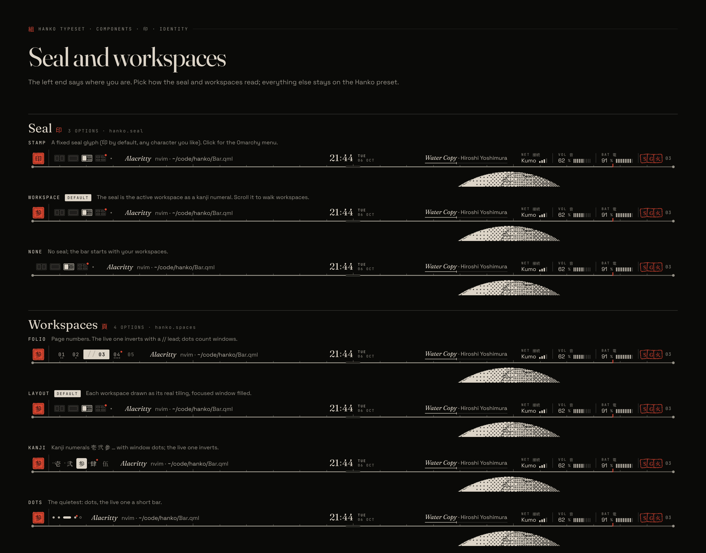
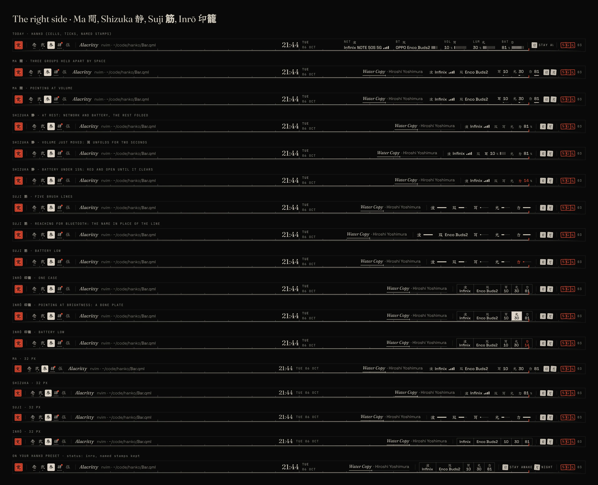
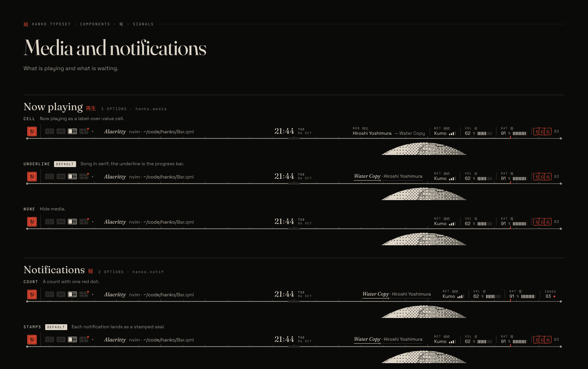
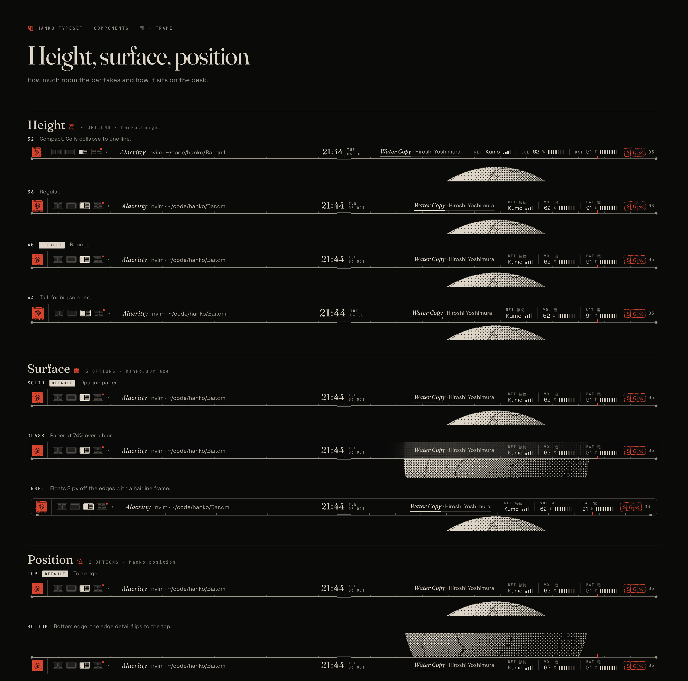
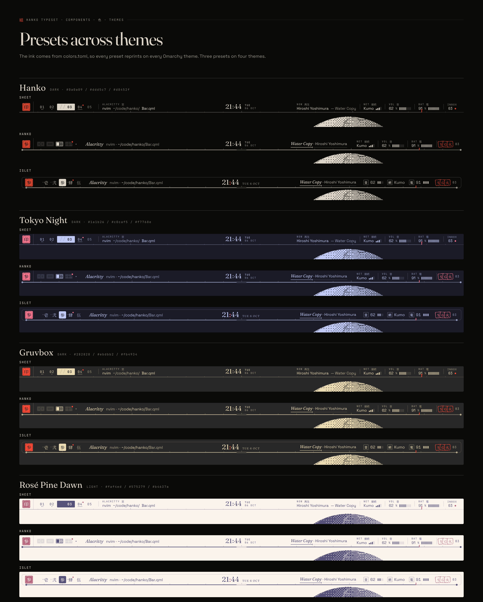
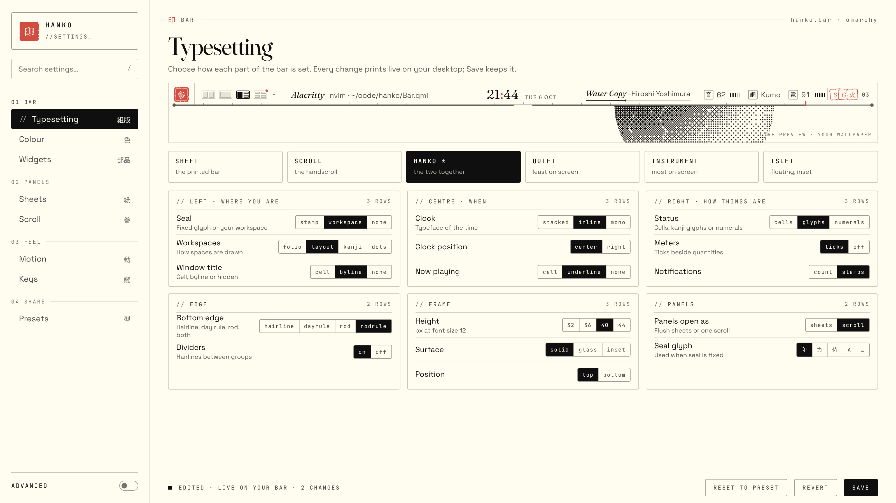

# Hanko: every component, every combination

Typeset merges the two earlier directions into one bar. Sheet (the printed running head) and Scroll (the calm bar that unrolls into a handscroll) are no longer rival designs. Each of their parts is now an option on one setting, chosen on Hanko's own settings page.

- **Sheet** is the Sheet design as drawn.
- **Scroll** is the Scroll design as drawn.
- **Kamon** 家紋 (the family crest; it was called Hanko) is the merge, and the default.

Twenty-three settings give **2,609,192,632,320** distinct bars before you even change the seal glyph or the theme. Every one of them still reads as Hanko, because every option is drawn from the same three things: paper, four inks and one seal red.


## Contents

1. [The rules every option keeps](#1-the-rules-every-option-keeps)
2. [The twenty-six settings](#2-the-twenty-six-settings)
3. [How options interact](#3-how-options-interact)
4. [Presets](#4-presets)
5. [Counting the combinations](#5-counting-the-combinations)
6. [The settings page](#6-the-settings-page)
7. [Config file](#7-config-file)
8. [Sheets](#8-sheets)

---

## 1. The rules every option keeps

These rules are what let any combination look designed rather than assembled.

| Rule | Why it matters |
|---|---|
| **One paper, four inks, one red.** All colour comes from Omarchy's `colors.toml`. Paper is `background`; ink is `foreground` stepped to 12, 9, 6.2 and 4.6 : 1; seal is `red`. | No option can introduce a colour, so no combination can clash. |
| **Red means "you" or "now".** The seal, the now-notch, an urgent workspace, a muted master fader, an unread dot. Nothing else is red. | Red stays a signal whatever you turn on. |
| **Emphasis is inversion.** The selected thing becomes a solid ink plate (folio page, kanji page, index tab, settings segment). | Every option highlights in the same way. |
| **Three typefaces with fixed jobs.** Fraunces for time, titles and bylines; Space Grotesk for values; your Omarchy mono for labels; Noto JP for kanji. | Swapping a clock style changes the face, never the system. |
| **One type scale, read at 1x.** Every size comes from `core/Type.qml`: mono tag 9 / label 10 / eyebrow 11 / figure 12, text note 12 / value 13 / row 14, Fraunces byline 15 / clock 22 / title 40 / hero 46, kanji gloss 9 / 11 / 13 (at a 12 px Omarchy font). Nothing anyone reads is under 10 px, text at 11 px or less is never in `inkFaint`, labels and bar values are Medium, and kanji glosses stay as small as their label's capitals. | The mockups were drawn at 2x; on a 1x laptop panel anything smaller turns to smudge. |
| **Hairlines, not shadows.** Dividers, frames and the edge are 1 px ink lines. | Glass and inset surfaces still look printed. |
| **One baseline.** Every zone sits on the same text baseline at every height. | Mixing cells, glyphs and numerals never wobbles. |

---

## 2. The twenty-six settings

Each setting has a key (used in the config file), its options, the default (from the Kamon preset), and where it came from. **Sheet** and **Scroll** are the two earlier designs; **New** is new in Typeset; **Shōji** came from the Shōji design when it was folded into Hanko, drawn with its parts.

### Left: where you are



#### Seal `seal` 鑑

| Option | What it does | From |
|---|---|---|
| **`stamp`** (default) | A fixed glyph (鑑 by default; any character). Click for the Omarchy menu, right-click for a terminal. | Sheet |
| `workspace` | The seal shows the active workspace as a kanji numeral (壱 弐 参 …). Scroll on it to walk workspaces. | Scroll |
| `carved` | Shōji's seal: your glyph as an ink outline, carved at the edge. With `notif: seal` it carries your letters: pressed red with their count beside it while any wait, and then a click opens the inbox, middle-click is do not disturb and right-click the Omarchy menu. | Shōji |
| `none` | No seal. The bar opens with the workspaces. | New |

The glyph used by `stamp` is a separate free-text setting, `sealGlyph` (鑑 漢 観 寛 …). It is not counted in the combinations below.

#### Workspaces `spaces` 頁

| Option | What it does | From |
|---|---|---|
| `folio` | Page numbers `01 02 // 03 04`. The live page inverts with a `//` lead; dots under a number count its windows; a red dot marks urgent. | Sheet |
| `layout` | Each workspace drawn as its real tiling in hairlines. The live one is outlined and its focused window filled. Hover opens it to show window names. | Scroll |
| **`kanji`** (default) | Kanji numerals 壱 弐 参 with window dots; the live one inverts. | New |
| `dots` | The quietest: one dot per workspace, the live one a short bar, urgent a red dot, empty an open ring. | New |
| `brush` | Shōji's desks: numerals (Arabic, or 一 二 三 with `numerals: kanji`), a faint brush mark sliding under the live one, a dot under a busy one, the 未 stamp on an urgent one. | Shōji |

#### Window title `title` 窓


| Option | What it does | From |
|---|---|---|
| `cell` | The app as a tracked mono label (`ALACRITTY 窓`) over the title. | Sheet |
| **`byline`** (default) | The app in serif italic like an author's byline; title in grotesk; path parts recede. | Scroll |
| `ink` | Shōji's: the app, then what it shows (the file, else the title), in Space Grotesk, the second a tier fainter. | Shōji |
| `none` | No title. | New |

### Centre: when

#### Clock `clock` 時

| Option | What it does | From |
|---|---|---|
| **`stacked`** (default) | Serif time, with the day and date stacked in small mono beside it. | Sheet |
| `inline` | Serif time with a red colon and a small-caps date on the same line. | Scroll |
| `mono` | All mono, for an instrument look. | New |
| `season` | Shōji's: the time in Fraunces, the date (Tue 6 Oct), and after a hairline the solar term by the clock (秋分, or *Autumn equinox*), as `season` sets it; with `season: off`, the time and date only. | Shōji |

#### Clock position `clockAt` 中

| Option | What it does | From |
|---|---|---|
| **`center`** (default) | Anchored to the exact screen centre. | Sheet, Scroll |
| `right` | Joins the end of the right cluster, after a divider; the centre stays empty. | New |

#### Now playing `media` 再生

| Option | What it does | From |
|---|---|---|
| `cell` | `NOW 再生` label over artist and song. | Sheet |
| **`underline`** (default) | Song in serif italic; its underline is the progress bar. | Scroll |
| `ink` | Shōji's: three level bars (faint while paused), the title, the artist a tier fainter. | Shōji |
| `none` | Hidden. | New |

### Right: how things are

#### Status `status` 音


| Option | What it does | From |
|---|---|---|
| **`cells`** (default) | `NET 波 / BT 双 / VOL 耳 / LUM 光 / BAT 力` label-over-value cells (the plainest kanji that say it, so the glosses stay clean at 1x; 充 while charging), held together as one group by space alone (the zones keep their rules); a Bluetooth device's charge is a half-length meter. | Sheet |
| `glyphs` | A boxed kanji is the icon and the number is the state. Solid red when it needs you; dashed when off. | Scroll |
| `numerals` | Mono labels and numbers on one line (`VOL 62 · NET Kumo · BAT 91%`). | New |
| `ink` | Shōji's: a line icon and a figure for each reading (Wi-Fi's name and the Bluetooth device's come out when you point at them), brightness a sun, the battery an ensō that closes as it fills, a bolt while charging. Meters do not apply. Red still means it needs you. | Shōji |
| `ma` | 間 Three groups held apart by space, no lines: the links (`波 Infinix`, `双 Enco Buds2`, each name cut to a glance), a 30 px pause, the levels (`耳 10 · 光 30 · 力 81`, a two-pixel fill under each figure in place of ten ticks), then the marks. The kanji is the label. | Right side |
| `shizuka` | 静 Quiet until something changes. Network and battery stay; Bluetooth, volume and brightness wait as faint kanji. When one moves it unfolds in place (figure and five ticks) for two seconds and folds back; pointing anywhere on the zone unfolds them all. A reading that needs you stays open, in red. | Right side |
| `suji` | 筋 A kanji and one 30 px brush line each, its length the level (network by its bars, Bluetooth by the device's charge), the rest of the range dotted. The figure or name takes the line's place on reach (pointer or a change). | Right side |
| `inro` | 印籠 One ruled case of compartments, kanji over value (`波 双 耳 光 力` over `Infinix · Enco Buds2 · 10 · 30 · 81`); the compartment under the pointer is a bone plate; at 32 px each is one line, the value alone. | Right side |

The last four are the right-side studies ([right-side/README.md](right-side/README.md), sheets in `right-side/images/`), made to clear a crowded right zone: meters do not apply to them, and each has a preset of its own.



#### Meters `meters` 目盛

| Option | What it does | From |
|---|---|---|
| **`ticks`** (default) | Volume, battery and brightness get a ten-tick ruler beside the number; Wi-Fi gets four signal bars. | Sheet |
| `off` | Numbers only. | Scroll |

All six status × meters pairs are drawn on sheet 12.

#### Notifications `notif` 報



| Option | What it does | From |
|---|---|---|
| `count` | `INBOX 03` with one red dot. | Sheet |
| **`stamps`** (default) | Each notification is a small stamped seal of its app's initial, slightly askew, newest on top. Hover fans them out. | Scroll |
| `seal` | The letter count goes onto the seal (`seal: carved` presses it red) and the inbox cell goes; the inbox sheet opens under the seal. With no seal showing, the inbox stays as `count`. | Shōji |

#### Bluetooth `bluetooth` 藍

| Option | What it does | From |
|---|---|---|
| **`device`** (default) | A `BT 双` cell after the network cell: the connected device's name (`+1` for each more) with its battery as the meter, or `On` / `Off`. | New |
| `marks` | One kanji mark per connected device, by its kind: 耳 headphones, 響 speaker, 鍵 keyboard, 鼠 mouse, 話 phone, 遊 controller, 機 computer, 器 anything else. In cells each mark is a small box its charge fills from the bottom; in glyphs the charge is a rule under the mark; four at most, then `+N`. | New |
| `count` | How many devices are connected, as a two-digit count, and a dot for each (six at most). | New |
| `off` | No Bluetooth cell. The panel is still in the scroll and on Omarchy's hotkey. | New |

In every style a click opens the Bluetooth panel and a middle- or right-click turns Bluetooth on or off; machines without an adapter never show the cell. A device at 15 % or less turns its mark, its dot or the count red (it needs you). The old `on` still reads as `device`. Added after the Typeset mockups were drawn, in the same grammar as the other status cells.

#### Indicators `indicators` and indicator marks `indicatorStyle` 鑑

Omarchy's six indicators (screen recording, dictation, reminder, stay awake, night light, do not disturb) as small square stamps in the right zone, before the inbox. One that is on is pressed down slightly askew (the stamp press, like a new notification); hovering the stamps straightens them, and hovering one opens its name in small caps to its left, pushing the zone over (the stamps never move). A click does what Omarchy's indicator does: stops a recording or opens the capture menu, opens dictation's settings, lists reminders (right-click adds one), or switches stay awake, night light or do not disturb.

| `indicators` | What it does |
|---|---|
| `all` | All six, the ones that are off as faint outlines to click on. |
| **`active`** (default) | Only the ones that are on. |

| `indicatorStyle` | What it does |
|---|---|
| `icon` | Omarchy's own icon in the stamp (the Nerd Font glyph its bar uses), readable without the kanji. Red only for "now": a recording and live dictation are solid red; transcribing shows an hourglass. |
| `kanji` | The kanji, the plainest that say it: 写 recording, 言 dictation, 予 reminder, 目 stay awake, 月 night light, 休 do not disturb. One that is on is a small seal like the one at the far left, carved in ink (a bone plate, an inner rule, serif kanji); only one that means "now" (recording, dictation) is red; off, a faint outline like an off icon stamp. |
| `iconname` | `icon`, with the name in small caps beside each one that is on. |
| **`kanjiname`** (default) | `kanji`, with the name beside each one that is on. |

The name is in the same ink as the icon styles (red only for a recording or live dictation). The old `full` reads as `iconname`. Each indicator can be hidden on the Widgets page. Added after the Typeset mockups were drawn.

### Edge

#### Bottom edge `edge` 軸


| Option | What it does | From |
|---|---|---|
| `hairline` | A single hairline. | Sheet |
| `dayrule` | A 24-hour ruler: hour ticks, longer every six hours, the spent part of the day brighter, a red now-notch. | Sheet |
| `rod` | The scroll's roller with end caps and a centre grip. Hover raises the grip; drag down to unroll. | Scroll |
| **`rodrule`** (default) | The roller carries the day: the hours to come a hairline that thins out at both ends, the spent part one stroke of ink darkening toward the red now-notch, ticks lighter ahead of now, and the grip shown only when the pointer reaches for it. | New |

#### Dividers `rules` 罫

| Option | What it does | From |
|---|---|---|
| **`on`** (default) | Hairline dividers between groups. | Sheet |
| `off` | Groups separated by space alone. | Scroll |


#### Pointer `pointer` 指

| Option | What it does | From |
|---|---|---|
| **`plain`** (default) | Each cell shows its own hover (a status reading's faint plate, the stamps fanning out). | Typeset |
| `brush` | Shōji's: a faint brush mark slides under the cell you point at, along the bar's foot (its top at `position: bottom`). | Shōji |
### Frame



#### Height `height` 高

| Option | What it does |
|---|---|
| `32` | Compact. Two-line cells collapse to one line (see §3). |
| `36` | Regular (Sheet's height). |
| **`40`** (default) | Roomy (Scroll's height). |
| `44` | Tall, for large or high-DPI screens. |

#### Surface `surface` 面

| Option | What it does |
|---|---|
| **`solid`** (default) | Opaque paper. |
| `glass` | Paper at 74 % over a background blur. The ink ramp does not change, so contrast holds. |
| `washi` | Shōji's paper: solid, with long faint fibres, as fine as `grain` sets them. | Shōji |

#### Float `float`

| Option | What it does |
|---|---|
| **`flush`** (default) | The bar sits on the screen's edge. |
| `inset` | Floats 8 px off the screen edges with a hairline frame and 7 px corners, whatever the surface (washi or glass can float too). It was `surface: inset`; a saved one reads as `surface: solid`, `float: inset`, and `hanko style set surface inset` sets `float: inset`. |

#### Position `position` 位

| Option | What it does |
|---|---|
| **`top`** (default) | Top edge. |
| `bottom` | Bottom edge. Edge details move to the bar's top side (see §3). |

Position follows Omarchy's own `bar.position` when you have not set it in Hanko.

#### Form `form` 印

What the bar is ([shell-concepts/inkan/](shell-concepts/inkan/README.md)).

| Option | What it does |
|---|---|
| **`bar`** (default) | The strip across the screen, everything above. |
| `inkan` | The seal only: the strip is taken away and one seal sits in a corner, reserving no space. Its carving is the status: the strokes wear away as the battery falls under 60 %, a chipped corner is a letter waiting (two for three or more, deeper when one is urgent), an outline is do not disturb, a broken inner rule is offline. Its glyph is the seal glyph, or the workspace numeral under `seal: workspace`. A press (or `hanko press`) prints **No. 00**, every sheet on one: the clock and date, the workspaces and the window you are in, now playing, then a row per sheet with its reading, each opening that sheet in its own hand. Under `panels: scroll` the press unrolls the scroll instead. Recording or dictation draws a thin red ring around the seal. Omarchy is told the bar is 0 px tall. |

Per monitor like every setting: `monitors.eDP-1.form = inkan` makes a laptop all seal beside a full bar on the desk screen. A shuffle never changes it.

#### Seal corner `inkanAt` 隅

| Option | What it does |
|---|---|
| `top-left`, `top-right`, `bottom-left`, **`bottom-right`** (default) | Where Inkan's seal sits, 18 px in from the corner; its sheets print away from the edge it shares. Dragging the seal snaps it to the nearest corner for that monitor. Only read under `form: inkan`; a shuffle never changes it. |


#### Shōji's touches `season` 季, `numerals` 数, `grain` 繊

Three switches beside the twenty-six (like `typeSize`: global, not per monitor, kept by presets, resets and shuffles, not counted in the combinations). They were the Shōji design's touches; a saved `touches` is read into them.

| Key | Options | What it does |
|---|---|---|
| `season` | `off`, **`kanji`**, `english` | The solar term by the clock (`clock: season`) and the micro-season in the Shōji Time panel |
| `numerals` | **`arabic`**, `kanji` | Workspace numbers in `spaces: brush` and on the Shōji panels |
| `grain` | `smooth`, **`fine`**, `toothy` | The washi's fibres (`surface: washi`, the Shōji panels) |
### Panels

#### Panels open as `panels` 紙/巻

| Option | What it does | From |
|---|---|---|
| **`sheets`** (default) | Clicking a cell inverts it and a flush sheet drops from it, joined to the bar: a mini settings page with eyebrow and folio, serif title over its faint kanji, an italic standfirst, underscored `//` groups and a colophon action strip. | Sheet |
| `scroll` | Every panel lives on one handscroll that unrolls from the bar, its edges finished by the `sides` setting, with an index plate and an interlude between each two sections. Pan with `H` `L`. | Scroll |

Sheets 20–25 show both on full desktops.

#### Sheet hands `sheetStyles` 帳/短冊/将棋/算盤/縅/霞/障子

Each cell's sheet can be drawn in one of seven hands, chosen per sheet on Settings › Sheets 紙 (or `hanko style set sheetStyle:sound tanzaku`, `sheetStyle:all kasumi`). Like the overview, it sits beside the twenty-six: no preset sets it and a reset keeps it. Every hand sends the same requests, so what a sheet can do does not change, only how it is laid out.

| Hand | What it does | After |
|---|---|---|
| **`ledger`** 帳 (default) | The editorial page above: eyebrow and folio, serif title over its faint kanji, standfirst, `//` groups of hairline rows, colophon foot. Everything listed. | Hanko's own sheet |
| `tanzaku` 短冊 | Each choice is a tanzaku, the tall slip a poem is written on and hung up: slips hang by short cords from a rail (a rod with a knot at each end) and run **right to left**, as vertical writing does. A slip carries its kanji at the head, its name down it sideways (Latin turned, as vertical Japanese sets it) and a short figure upright at its foot (tate-chū-yoko); it hangs **as far as its level** (an app's volume, a network's signal, a device's charge), or at rest when it has none. The one in use is inked with a small red seal at its foot; an urgent one has the seal hanging under it; muted or switched-off slips are dashed. Under the pointer a slip swings a little on its cord. The first, wider slip carries the sheet's kanji brushed large, its reading, and a wash of ink down it as far as the level; where that level is yours to set (volume, brightness) you pull the slip: drag down it or scroll. | Tanzaku (about 36 × 5.5 cm, cut eight from a sheet of kaishi), Tanabata slips, vertical setting (JLReq) |

What each sheet hangs:

| Sheet | Tanzaku |
|---|---|
| Time | the time on the first slip, the day spent washed down it; a week of slips headed 月 火 水 木 金 土 日, dates at their feet, today inked, days gone dashed; other cities under the rail |
| Sound | the master on the first slip (pull it); a slip per output (出; a click plays there) and per app playing, as long as its volume (a click mutes it) |
| Network | the signal of the network you are on; a slip per network, as long as its signal (a click joins) |
| Bluetooth | the connected device's charge; a slip per device, as long as its charge (a click connects, disconnects or pairs) |
| Power | the battery; a slip per profile (a click runs it); cycles and capacity as quiet slips |
| Display | the brightness (pull it; never under 1%); a slip per monitor, one switched off dashed |
| Inbox | the count; each letter a slip, newest at the right, the app's mark at its head and its age at its foot |

The four craft hands (`shogi`, `soroban`, `odoshi`, `kasumi`) draw one model per sheet (`core/Hands.js`): a **hero** (the sheet's figure, an italic line, a mono caption, and its level when it has one), **levels** (things with a level: an app's volume, a network's signal, a device's charge, a letter's freshness, which wanes over eight hours), **choices** (things you pick one of: an output, a profile, a monitor, a day of the week) and quiet **lines** (other cities, battery details). Red stays for the sheet's own reading, the thing in use and anything urgent.

| Hand | Levels | Choices | After |
|---|---|---|---|
| `shogi` 将棋 | A rank of nine squares each, file numbers ９…１ over the board, rank numerals 一 二 三 down its side, hoshi dots; the level's piece (koma) stands on its square, the squares it crossed washed (red for the sheet's own). A click on a square moves a piece you can set, the wheel steps a file; a muted app's piece is turned away. | Pieces on the piece stand (komadai) under the board, named beneath; the one in play promoted, its character red. | Shōgi boards and pieces; a promoted piece's red reverse |
| `soroban` 算盤 | The figures counted on rods, tens and units (hundreds when needed), heaven bead five, earth beads one, a spare rod and unit dot between readings, the sheet's own beads red; a click on a bead counts to it. Levels the frame does not count are a wire of ten beads, as many home as the level. | One bead on a short wire each, slid across for the one in use; a week is one wire of seven beads, the days gone and today pushed home. | The soroban (1:4 beads) |
| `odoshi` 縅 | A crown plate (kanmuri-ita) carries the figure; its lame laced scarlet to the level (24 scales, an hour each, on Time). Every other level a lame of small scales laced in ink as far as it goes (kebiki), sparsely beyond (sugake), scarlet when urgent; a click on a scale laces to it. | A lame each: the one in use laced in full and cross-knotted red along its foot (hishinui); a week is one lame of seven runs of scales, today laced scarlet. | Ō-yoroi sode, kozane, hi-odoshi |
| `kasumi` 霞 | The figure with its kanji set large at the right like a title slip, its band the fullest gilt beneath; every other level a band of gold-leaf mist (suyari-gasumi) as long as its level, drifting in from alternate sides; click or drag along a band to set it. Muted: a thin mist with no gold. | The one in use a band gilded the whole width and sealed red; the others short, thin mist; a week is a row of gold squares (shikishi), today sealed. | Yamato-e emaki, Rinpa gold screens |

What the craft hands show per sheet:

| Sheet | Hero | Levels | Choices |
|---|---|---|---|
| Time | the time; the day spent | week, month, year spent (the abacus counts hour, minute, day) | the week, today sealed; ‹ Week · Today · Week › |
| Sound | the master (set it) | each app's volume (set it; muted shows as muted) | the outputs |
| Network | the signal | each network by signal (a click joins) | — |
| Bluetooth | the connected device's charge | devices that report a charge | devices that don't |
| Power | the battery | — (the abacus counts charge and the numeric details) | the profiles |
| Display | the brightness (set it, never under 1%) | — | the monitors, one switched off faint |
| Inbox | the count | each letter, reaching as far as it is fresh, urgent ones red | — |

`shoji` 障子 is the Shōji panels (`bar/sheets/ShojiPanel.qml`), drawn in Shōji's skin (`core/Skin.js`: washi at 86% unless Panel opacity is set, cut corners, the lattice, jo-ha-kyū timing, and your season, numerals and grain touches). Unlike the other hands it is not printed flush from the cell: it hangs on a rail 6 px below the bar, slides in from the side of the screen its cell is on, and when another cell is clicked the same panel slides along the bar to it. Its name is written down the right edge (時 Time, 音 Sound, 繋 Network, 藍 Bluetooth, 電 Power, 明 Display, 便り Letters).

| Sheet | Shōji |
|---|---|
| Time | the day as a sentence, the month with today in an ensō, the micro-season (kō) in tategaki when the season touch is on, other cities |
| Sound | the master as a figure you scroll, the brush slider, Plays on with the ink-wash selection, a brush slider per app, the microphone switch |
| Network | the Wi-Fi switch, the network's name as the hero, nearby networks (a click joins; R rescans) |
| Bluetooth | the switch, the connected device with its charge on an ensō, connected, your devices and nearby (a click connects, disconnects or pairs) |
| Power | the battery as an ensō, how long it lasts, power mode as sliding doors, lock, sleep, and restart and shut down held to confirm |
| Display | the brightness as a figure you scroll and a brush slider (never under 1%), night light, the monitors (a click chooses; Arrange › opens monitors.lua) |
| Inbox | Letters: the Quiet switch, each letter with its 未 unread seal, show recent again, clear all |

#### Scroll dividers `interlude` 間

What sits between two sections of the scroll. Pick it on the Scroll 巻 page (a gallery that draws each one) or by kanji in the Panels card; from a terminal, `hanko style set interlude kotoba`. Every divider is quieter than the sections, and red appears at most once in a gap. They replace the dithered ink slivers the Scroll design drew; the research and the full set of studies are in `docs/revision1/` on the `docs` branch.

| Option | What it does | Presets |
|---|---|---|
| `ma` 間 | Nothing: the gap's space alone separates the sections. | Quiet |
| `hairline` 罫 | One rule that fades at both ends, with a small ring at its middle. | |
| `folio` 柱 | A ruler with ticks like the day rule, and both section numbers (`01 — 02`) set sideways. | Sheet, Instrument |
| `kotoba` 詞 | The next section's red kanji and its number and name set vertically, between two hairlines (a text column, as handscrolls put text between pictures). | Scroll |
| `tsugime` 継 | A paper join: the next sheet laps over the last, with a soft shadow on the earlier one. | |
| **`seal`** 鑑 (default) | The paper join, with a seal of the next section's kanji pressed across it, half on each sheet. | Hanko |
| `jiku` 軸 | A slim inner roller with caps, echoing the rollers the scroll once had at its edges. | |
| `fuda` 札 | A bone index tab with the next section's red kanji and number, on a faint line. | Islet |
| `su` 数 | The next section's number, large in the display face and set sideways, with a red point. | |

Added after the Typeset mockups were drawn.

#### Scroll end leaf `endleaf` 跋

What sits on the bare paper right of 08 Inbox, the twin of the weather leaf on the left: `09 // …`, 400 px wide, shown while Inbox is in the middle (the index plate and the number keys skip it, as they skip the weather). Pick it on the Scroll 巻 page (a gallery that draws each one with a sample reading) or by kanji in the Panels card; from a terminal, `hanko style set endleaf shimai`. `hanko hide endleaf` (or the Widgets page, Centre card) leaves the paper bare. The designs and the research behind them are in `docs/revision2/` on the `docs` branch.

| Option | What it shows, and what it does | Presets |
|---|---|---|
| `okugaki` 奥 | A colophon, the way a handscroll ends: host and model, kernel, Hyprland, packages and the last upgrade, theme, font and Hanko's version, with three seals (your initial, your theme's, 判). | Scroll |
| **`koyomi`** 暦 (default) | The almanac: the month (Monday first) with today sealed and a dot on the day the next solar term starts; the solar term (sekki) and microseason (kō) we are in; the moon's phase and the next new or full moon; the year as a rule. Pure date maths, no network. | Hanko |
| `kiki` 機 | The machine: CPU over the last hour as one ink curve (a sample a minute, kept while this leaf is chosen), CPU, memory, disk and heat as tick meters, and the two busiest processes. | Instrument |
| `shimai` 終 | The session: Lock, Suspend, Log out, Restart and Shut down as seals, each pressed by holding it (700 ms, the seal fills with ink); the same commands as Omarchy's system menu. | Sheet |
| `iro` 色 | Omarchy's themes as paper, ink and seal swatches around the current one; a click runs `omarchy-theme-set`, and the foot opens Omarchy's theme picker. | |
| `dougu` 具 | Omarchy's utilities as tiles: screenshot, record, colour picker, stay awake, night light, silence (do not disturb), emoji, clipboard, lock. The switches show when they are on. | Islet |
| `shuchu` 集 | A focus timer: 25 minutes on a ruler with the red now-notch, today's sessions stamped, pause, +5 min and stop; a five-minute break follows each one. It keeps time with the scroll rolled up (state in `~/.local/state/hanko/focus.json`) and sends a notification when a part ends. | |
| `hikae` 控 | Today's list from `~/.config/hanko/notes.md` (`- [ ]` lines tick on a click and are written back), with the last three entries of Omarchy's clipboard history (a click copies one). | |
| `batsu` 跋 | An afterword: a large 終, "the end of the scroll", the date, and your seal glyph. Nothing to read or do. | Quiet |

Each leaf reads only what it shows and only while the scroll is open (services/Leaf.qml), apart from the machine's hourly curve and the focus timer.

The panels are Time 時, Sound 音, Network 網, Bluetooth 藍, Power 電, Display 明 and Inbox 報 (as sheets), and the scroll adds Spaces 窓 between Display and Inbox: eight sections. Display is the LUM cell's panel (and Omarchy's `omarchy.monitor`, `Super+Ctrl+D`): the chosen monitor's brightness on a ruler, every monitor with its mode and scale, and night light. It was added after the Typeset mockups were drawn, in the same grammar. So was Bluetooth (the BT cell's panel and Omarchy's `omarchy.bluetooth`): what is connected as the title, then connected, known and nearby devices (the adapter scans only while the panel is open); a click disconnects, connects or pairs through `omarchy-bluetooth-device`, and the foot turns it on or off through `omarchy-bluetooth-power`.

**The weather leaf 天.** With `panels: scroll`, Time sits in the middle of the paper when the scroll opens, which left bare paper to its left. A weather leaf (`00 // WEATHER`, not a section: the index plate and the number keys skip it) now fills it and slides away with Time:

- the title is the temperature and the sky (`18°, rain`), the caption the place, how it feels and the wind;
- today's temperature by the hour as one curve, the hours already spent fainter, daylight as a faint wash, rain chances as bars along the foot, the red now-notch where it meets the curve, the day's high and low;
- sunrise, sunset and humidity, and the first hour with a 50 % chance of rain;
- the next three days, each with its kanji (晴 月 曇 霧 雨 雪 雷) and its low to high on the span the four days share.

It uses the same data as Omarchy's own weather panel, so it needs no setting: the place from `~/.local/state/omarchy/settings/weather.json` (or found from your IP address through wttr.in when that has no coordinates), the forecast from Open-Meteo, °C or °F from the `unit` on the `omarchy.weather` entry, else your country, else your locale. It refreshes every 15 minutes (the entry's `refreshMinutes`, 5 at least) and only while the scroll is open. The leaf is 400 px wide and is left out when the screen is too narrow to fit at least 240 px of it beside Time (about 1600 px of scroll). `hanko hide weather` (or the Widgets page, Centre card) takes it off.

---

#### Scroll sides `sides`

What finishes the scroll's left and right edges. The rollers with caps that stood there felt heavy next to the paper, so they are gone; ten alternatives were drawn in `docs/revision3/` on the `docs` branch and two were built. Set it on Settings › Scroll or with `hanko style set sides bare`.

| Option | What it is | Presets |
|---|---|---|
| `bare` | No rollers and no side lines: the paper simply meets the screen. | Sheet, Quiet, Instrument |
| **`curl`** 巻 (default) | A soft shaded fold, 22 px, at each edge, as if the paper rolls under; no caps. | Scroll, Hanko, Islet |

Added after the Typeset mockups were drawn.

#### Scroll guides `guides`

What helps you find your way on the scroll: the index plate of tabs (on top; below for a bar at the bottom) and the position bar along the foot with its `H` `L` and `Esc` keys. Hiding them leaves the paper alone; the sections do not move. Set it on Settings › Scroll or with `hanko style set guides tabs`.

| Option | What it shows | Presets |
|---|---|---|
| `both` | The tabs and the position bar. | Sheet, Scroll, Quiet, Instrument, Islet, Shōji |
| `tabs` | The tabs only. | |
| `foot` | The position bar only. | |
| **`none`** (default) | Neither: bare paper. Panning by drag, wheel and keys still works. | Hanko |

Added after the Typeset mockups were drawn.

### Workspace overview 一覧 (not a setting)

Right-click the workspaces (or `omarchy-shell hanko overview`) and every screen lays out its workspaces on a sheet of the theme's paper, under the bar. Workspaces 1–10 (the ten the live one is in) sit in two rows of five pages, a row with nothing on it folded away. Each page has a folio band (number, kanji numeral, how many windows, a red dot when urgent; the live page's number inverted with `//`) over its screen: every window where it really sits, framed in hairlines, live, with its name on a tab (bone for the focused one, ◇ for a floating one). A bare page shows its kanji, large and faint. Every page lies on the sheet with the short paper shadow Hanko's window style gives Hyprland's windows, in ink, stronger under the live page. Arrows or hjkl switch the workspace while the overview stays open, 1–9 and 0 jump, the wheel walks them; a click on a page or a window goes there; dragging a window onto another page moves it there without following; middle-click closes a window; Enter, Esc or a click away is done.

`overview: dynamic` (Panels card, or `hanko style set overview dynamic`) opens Ryoku's layout instead: only the workspaces with windows and the live one, as live mini-desktops over the dimmed wallpaper, packed into as many centred rows as fit, then a + cell that opens the next free workspace; desktops (blocks of ten workspaces) along the top with a NEW card; Tab, the arrows and the wheel move a selection, Alt+Tab steps desktops, Enter or a click goes, ✕ on a window closes it, dragging moves a window to a workspace or a desktop. It is not counted in the combinations.

`overview: framed` (or `hanko style set overview framed`) keeps the grid and its keys but prints each page as Shōji does: washi in a lattice frame (a hairline inside the edge, its joints marked), the kanji numeral in the page's head with its number in Fraunces, a quiet window count, a 急 dot on an urgent one. It follows Panel opacity. The Shōji preset frames it.

## 3. How options interact

Most settings are independent. These are the places where one setting changes how another is drawn. None of them forbid a combination; they adapt it.

| When | Then |
|---|---|
| `height: 32` | `cells` status and `cell` title/media collapse from label-over-value to one line (label then value). `stacked` clock puts the date beside the time instead of stacking. Seal shrinks to 22 px. |
| `status: numerals` + `meters: ticks` | A short five-tick ruler follows each quantity inline. |
| `status: glyphs` + `meters: ticks` | Four-tick ruler after the number; network keeps its name, no bars. |
| `clockAt: right` | The clock moves after notifications with a divider (if `rules: on`). The centre zone is left empty on purpose, so `media` stays in the right cluster. |
| `edge: dayrule` or `rodrule` + `clockAt: right` | The now-notch still sits on the ruler at the real hour; it no longer lines up under the clock, and that is fine. |
| `position: bottom` | `dayrule`, `rod` and `rodrule` draw along the bar's **top** side. A `scroll` unrolls **upward** and the index plate moves to the bottom; `sheets` rise instead of drop. |
| `surface: inset` | The edge (rod, rule) runs inside the frame, 10 px from each end, so the end caps don't touch the frame. |
| `surface: glass` | Stamps, the seal and inverted plates stay fully opaque; only the paper goes translucent. |
| `seal: workspace` + `spaces: kanji` | The active kanji appears twice (seal and inverted page). This is intended: the seal is a mark, the page is a control. |
| `seal: none` | The left zone starts at 14 px padding; the first divider is dropped. |
| `title: none` + `media: none` | The bar collapses to identity, clock and status: the Quiet preset. |
| `panels: sheets` + `edge: rod` | The rod no longer unrolls anything; dragging it opens the sheet for whatever cell is under the pointer, and `Super+Space` opens Time. |
| `panels: scroll` + no rod edge | `Super+Space` or a click on any status, clock or stamp unrolls the scroll; hovering the bottom edge shows a thin pull tab. |

---

## 4. Presets


A preset sets all twenty-six settings at once. Change any setting afterwards and the settings page shows `PRESET · KAMON + EDITS`; **Reset to preset** puts it back.

| Setting | Quiet | Islet | Shōji | **Kamon** |
|---|---|---|---|---|
| seal | stamp | workspace | carved | stamp |
| spaces | dots | kanji | brush | kanji |
| title | none | byline | ink | byline |
| clock | inline | inline | season | stacked |
| clockAt | center | center | center | center |
| media | none | underline | ink | underline |
| status | numerals | glyphs | ink | cells |
| meters | off | ticks | off | ticks |
| notif | count | stamps | seal | stamps |
| bluetooth | off | marks | device | device |
| indicators | active | active | active | active |
| indicatorStyle | icon | icon | icon | kanjiname |
| edge | hairline | rodrule | hairline | rodrule |
| rules | off | off | off | on |
| pointer | plain | plain | brush | plain |
| height | 32 | 36 | 40 | 40 |
| surface | glass | inset | washi | solid |
| position | top | top | top | top |
| panels | sheets | scroll | sheets | sheets |
| interlude | ma | fuda | ma | seal |
| endleaf | batsu | dougu | koyomi | koyomi |
| sides | bare | curl | bare | curl |
| guides | both | both | both | none |

- **Kamon** 家紋: the family crest, the bar Hanko is known by (this preset was called Hanko; `hanko` still names it, and a style.json that says Hanko loads it). The merge. A stamped seal and kanji pages, Sheet's cells, meters and flush sheets, Scroll's byline and stamps, named kanji indicators shown only when on, and the roller that carries the day.
- **Shōji**: the Shōji design, folded into Hanko: washi, the carved seal carrying your letters, brush desks, the season by the clock, icons and an ensō for status, a brush mark where you point. Picking it also puts every sheet in the Shōji hand and frames the overview (kept afterwards, like anything beside the settings). A style.json that names the Shōji design loads as this preset.
- **Quiet**: the least on screen. Dots, an inline clock, numerals, a hairline, on glass.
- **Islet**: a floating inset strip with kanji status and stamps.
- **Inkan** 印: the seal only. Kamon with `form: inkan`: nothing on screen but the seal in the bottom-right corner, which prints every sheet on one when pressed.

Sheet, Scroll and Instrument were presets once and were taken out; a style.json or `hanko style preset` that names one gets Kamon (Sheet, Instrument) or Islet (Scroll).

The four right-side studies are presets too: the Kamon bar with the right zone set each way, and the marks as stamps alone (their names on hover). Only these differ from Kamon:

| Setting | **Kamon** | Ma | Shizuka | Suji | Inrō |
|---|---|---|---|---|---|
| status | cells | ma | shizuka | suji | inro |
| meters | ticks | off | off | off | off |
| indicatorStyle | kanjiname | kanji | kanji | kanji | kanji |
| rules | on | off | on | on | on |
| height | 40 | 36 | 40 | 40 | 40 |
| interlude | seal | fuda | seal | seal | seal |

- **Ma** 間: room between the groups; no dividers anywhere, so space does all the grouping. It is the bar the user runs: 36 px, with index tabs (`fuda`) between the scroll's sections.
- **Shizuka** 静: quiet until it changes.
- **Suji** 筋: five brush lines.
- **Inrō** 印籠: one case for everything.



---

## 5. Counting the combinations

| Setting | Options |
|---|---|
| seal | 4 |
| spaces | 5 |
| title | 4 |
| clock | 4 |
| clockAt | 2 |
| media | 4 |
| status | 8 |
| meters | 2 |
| notif | 3 |
| bluetooth | 4 |
| indicators | 2 |
| indicatorStyle | 4 |
| edge | 4 |
| rules | 2 |
| pointer | 2 |
| height | 4 |
| surface | 3 |
| float | 2 |
| position | 2 |
| panels | 2 |
| interlude | 9 |
| endleaf | 9 |
| sides | 2 |
| guides | 4 |
| form | 2 |
| inkanAt | 4 |

4 × 5 × 4 × 4 × 2 × 4 × 8 × 2 × 3 × 4 × 2 × 4 × 4 × 2 × 2 × 4 × 3 × 2 × 2 × 2 × 9 × 9 × 2 × 4 × 2 × 4 = **31,310,311,587,840** bars.

That figure is before the seal glyph (any character) and the theme (every Omarchy theme, light or dark). The bar on screen alone, ignoring position, panels, the scroll's dividers, its end leaf, its sides and its guides (and Inkan's form and corner), is 1,509,949,440 combinations.


Sheet 04 draws twelve of them at random with a fixed seed. None is a preset. The settings page will have a **Shuffle** button that does the same, for discovering combinations you would not have picked.

---

## 6. The settings page




Hanko's settings open as their own window in the Ryoku Hub grammar: a numbered rail on the left, a page on the right, an action bar at the foot.

**Rail**

| Group | Pages |
|---|---|
| `01 BAR` | Typesetting 組版 · Presets 型 · Parts 部品 · Colour 色 · Screens 画面 |
| `02 PANELS` | Sheets 紙 · Scroll 巻 · Overview 一覧 |
| `03 FEEL` | Motion 動 · Keys 鍵 |
| `04 YOU` | Profile 印影 · About 由来 · Credits 謝辞 |

The window opens on Typesetting. Every page is its own file, built only while it is open, and keeps one rule (docs/settings-kosei): the thing itself first, pictures of its choices second, words last. The rail's foot lists the keys that work everywhere (`/` search, Ctrl+Z undo, Esc close, ← → parts on the proof). The action bar names the last change kept ("KEPT · CLOCK · STACKED → INLINE · 2 TO UNDO", `Settings.describeChange`), with Undo; Typesetting and Presets add Reset to preset, Presets Shuffle, Parts Show all.

**Parts 部品** (was Widgets) is a sorts tray: your bar as it stands (the galley, no marks), a count ("22 OF 26 ON THE BAR · 4 SET ASIDE"), then every part it can carry in bar order (`Settings.partsTray`), grouped Left, Centre, Right readings, Hanko's marks, tray apps, widgets from your Omarchy bar, Edge and scroll. Each is a sort: the real part cropped from your bar (`BarCrop.qml`; "not drawn here now" when there is nothing to draw, such as no backlight), an indicator's stamp, a tray icon or letter, a widget's initial, a leaf's kanji. Click to set it aside (faint, struck through, in a dashed outline; the bar above loses it); click again to put it back. Show all is in the action bar.

**Colour 色** shows what Hanko takes from your theme and lets you switch it. A drawdown (展色, the printer's ink test): Paper, then Ink, Dim, Muted, Faint and Red, each with what it is for, a strip of it drawn down on your paper (solid, thinning out), "21:44" and your seal glyph set in it, its hex, and its contrast on the paper against the tier's target (12, 9, 6.2, 4.6 : 1). Under it every Omarchy theme as a specimen in its own colours (`InkMath.ramp` steps its inks exactly as Hanko would): its paper, your seal in its red, three workspaces, the clock, its five inks, light or dark; the one in use is ringed and marked red; a click runs `omarchy-theme-set` (`Leaf.setTheme`). The themes are read when the page opens (`Leaf.loadThemes`).

The Advanced switch is gone. Your own seal glyph is typed into the last stone in 01 Seal's case. Per-monitor overrides and the raw style.json are on **Screens 画面**: your monitors drawn to scale where Hyprland places them, each with the bar it carries (a strip on its edge, or Inkan's seal in its corner) and a red count of what it sets for itself; pick one, and every setting a monitor can carry is listed by part as "name ……… value", a click opening its choices. Picking what the other screens get drops the override. `widgets` and `advanced` still open Parts and Screens.

**Profile 印影, About 由来 and Credits 謝辞** are plates, not pages: they fill the page like posters (the action bar shows only while there is something to save). They follow the grammar of Ryoku's Profile and Credits pages, with Hanko's own art drawn in code from the theme.

- *Profile*, the seal register, laid out like the certificate a seal is registered on (印鑑登録証明書) on a two-column grid: left, the holder (your name in 104 px Fraunces, `@host · time` and a line of your own) over the register's small print (preset and edits, which of the combinations this bar is, theme, compositor, kernel, uptime, Omarchy and Hanko versions) and the six inks you are set in; right, the work: your seal glyph written large in ink as a one-character work (一字書) and signed as calligraphy is, with a rakkan (落款) down its left margin: your name and the date the machine was set up, then two small vermilion seals, a square hakubun (白文, your initial cut white) and a round shubun (朱文, the glyph in a ring); in a ruled box on a calligraphy practice grid (田字格: dashed halves, dotted diagonals; the `watermark` block), crop marks off its corners, captioned and numbered with this machine's edition; across the foot, the bar's live readings (spaces, sound, network, power, inbox) as a row of stats in Fraunces, each with a hairline gauge where it has a level; then the edition and today as a rule with the now-notch. Narrow windows stack it: holder, impression, stats two or three to a row, small print. **EDIT**: click your name or line to rewrite it, an eye on each block hides it (watermark, seal, vitals, specs, palette, day, spine), Save image writes `~/Pictures/hanko-profile-DATE.png`, Reset clears it all. Kept in `~/.config/hanko/profile.json`.
- *About*: 判子 Hanko on one line, the deck, How it is made as leader lines, the three directions it was drawn in side by side, and the colophon in a ruled 奥付 box (each face set in itself, the inks with their contrast) under the moon, or in the column on a narrow page.
- *Credits*: 感謝 Gratitude on one line, the deck, every credit under three heads (Foundation 礎, Lineage 系譜, Type 活字; `Profile.js` `CREDIT_GROUPS`), and the proofreaders on a ruled card stamped 校.
- *About*: 判子 Hanko, a deck, how it is put together (kind, version, settings, files, commands, source), the three directions it was drawn in, and a colophon that sets each face in itself and prints the inks with their contrast; a whole dithered moon on the right.
- *Credits*: 感謝 Gratitude, everything Hanko stands on as editorial lines (a linked one inverts under the pointer and opens), and one bone placard for the people who test it; a hanging scroll with an ink landscape on the right.

**Widgets 部品** shows or hides anything the bar can show, each row `shown | hidden`, in cards: *Left* (seal, workspaces, window title), *Centre* (clock, now playing), *Right · readings* (network, Bluetooth, volume, brightness, battery, notifications), *Marks · Hanko's own* (each indicator, the keyboard layout, the microphone, the tray, as your Omarchy layout has them), *Tray apps* (each app in the tray now), *Widgets · from your Omarchy bar* (every hosted widget, marked Omarchy or third-party) and *Edge*. A part its own setting leaves out (`seal: none`, `title: none`, `media: none`, `bluetooth: off`) reads hidden, and showing it sets it back to the preset's way. Show all puts every hidden part back. Hiding is for this bar only: the widget stays in Omarchy's layout. From a terminal: `hanko hide <part>`, `hanko show <part>`, or `hanko style set show:<part> hidden`.

**Motion 動** holds one switch outside the twenty-six settings, `motion`: `paper` (default) moves like Scroll's motion sheet, `still` cuts every transition to its end frame. Omarchy's own animation switch, off, makes Hanko still too. The page lists every timing.

**Presets 型** is a pattern book (the dyers' stencil sample books): a row of nine swatches in three groups (Bars: Quiet 素, Islet 島, Shōji 障子, Kamon 家紋 · Seal only: Inkan 印 · Right-side studies: Ma 間, Shizuka 静, Suji 筋, Inrō 印籠), each a number, its kanji and name; the one on your bar is marked red. Click one to open it: its number, name and kanji, its blurb and telling facts, **Use <name>** (or ON YOUR BAR, with your edits on top), the pattern set as your bar in the two-line galley (no marks), and **what changes from your bar** (`Settings.presetDiff`): each setting that would change, numbered by its part, yours struck through → the pattern's. Double-click a swatch to use it at once. The search filters the swatches. The action bar adds **Shuffle** and **Reset to preset**.


**Typesetting 組版** is a proof (校正; design and research in [settings-kosei/](settings-kosei/README.md)). It holds every setting in this document except how panels open:

1. **The galley**: your bar, live, laid out at your screen's width and set in two lines (the left zone; then from just before the clock to the end), each close to its real size, each part numbered in the margin (01 Seal, 02 Workspaces, 03 Window title, 04 Clock, 05 Now playing, 06 Status, 07 Indicators, 08 Inbox). The bar's foot is 09 Edge, the paper around it 10 Frame. Hover brackets a part; a click opens its case. Under `form: inkan`, a small screen with the seal in its corner. Beside the title, the preset it starts from (FROM Ma 間 + 1 edit · PRESETS ›).
2. **The index**: the ten parts by number and name; a red dot on each part with edits.
3. **The case** of the open part: number, name, kanji and a line; what you changed from the preset, each with PUT BACK; a **specimen** of every way the part can be set (the real bar set that way, cropped to the part; the one in use inverted; hover tries it on the galley, a click keeps it); then **Also**, the choices that are words:
   - 01 Seal: *seal* · Glyph (鑑 漢 観 寛, or … for your own)
   - 02 Workspaces: *spaces* · Numerals
   - 03 Window title: *title*
   - 04 Clock: *clock* · Hours, Season, Sits (`clockAt`)
   - 05 Now playing: *media*
   - 06 Status: *status* · Meters, Bluetooth
   - 07 Indicators: *indicatorStyle* · Show (`indicators`)
   - 08 Inbox: *notif*
   - 09 Edge: *edge* · Dividers (`rules`), Pointer
   - 10 Frame: *form*, *surface* · Height, Type, Float, Position, Grain, Corner (`inkanAt`)
   
   Keys: ← → walk the parts, 1–9 and 0 open one. A search lights the parts that match.

How panels open (Panels open as, Scroll sides, Scroll guides, Overview) is a card at the top of **Scroll 巻**, over its dividers and end leaf.

4. **Action bar**: Shuffle (on Presets) · Reset to preset (on Presets and Typesetting) · Undo. There is no Save: every change prints live on your bar and is written to `style.json` at once; Undo (or Ctrl+Z) puts the last one back, as many times as you changed something since the window opened.

The same settings can be changed from a terminal:

```sh
hanko style get                 # print the current style
hanko style set clock mono      # change one setting
hanko style preset Islet        # apply a preset
hanko style shuffle             # random combination
```

---

## 7. Config file

Hanko stores its style alongside the rest of Omarchy's bar settings, so `omarchy bar use hanko.bar` keeps working and a theme switch does not touch it.

```jsonc
// ~/.config/hanko/style.json (outside the plugin folder, so updates never touch it)
{
  "preset": "Kamon",          // starting point
  "edits": {                  // only what differs from the preset
    "clock": "inline",
    "status": "glyphs"
  },
  "sealGlyph": "鑑",
  "motion": "paper",          // or "still": every move cuts to its end frame
  "hidden": ["tray", "hosted:omarchy.weather"],  // parts taken off the bar (Widgets 部品)
  "monitors": {               // optional per-monitor overrides
    "DP-2": { "height": 32, "spaces": "dots" }
  }
}
```

Resolution order: preset → `edits` → `monitors[name]`. Unknown keys and invalid values are ignored with a warning, so a config from a newer Hanko never breaks an older one.

In QML, the bar reads one resolved object:

```qml
property var style: Typeset.current   // 24 settings
Seal   { mode: style.seal }
Spaces { mode: style.spaces }
Clock  { mode: style.clock; anchor: style.clockAt }
Status { mode: style.status; meters: style.meters }
Edge   { mode: style.edge }
Panels { mode: style.panels }
```

---

## 8. Sheets

All images are in `docs/mockups/typeset/`, rendered from the HTML in `docs/mockups/typeset/source/` and saved as lossless WebP (`Image.open('out.png').save('out.webp', lossless=True, method=6)` with Pillow).

| File | Shows |
|---|---|
| `01-settings.webp` | The Typesetting settings page, Hanko theme |
| `02-settings-light.webp` | The same page on Flexoki Light |
| `03-presets.webp` | The six presets |
| `04-shuffle.webp` | Twelve random combinations |
| `05-presets-x-themes.webp` | Sheet, Hanko and Islet on Hanko, Tokyo Night, Gruvbox and Rosé Pine Dawn |
| `10-seal-workspaces.webp` | Seal × 3, workspaces × 4 |
| `11-title-clock.webp` | Title × 3, clock × 3, clock position × 2 |
| `12-status-meters.webp` | Status × meters, all 6 pairs |
| `13-media-notifications.webp` | Now playing × 3, notifications × 2 |
| `14-edge-dividers.webp` | Edge × 4, dividers × 2 |
| `15-height-surface-position.webp` | Height × 4, surface × 3, position × 2 |
| `16-seal-workspaces-flexoki-light.webp` | Sheet 10 on Flexoki Light |
| `17-status-meters-rose-pine.webp` | Sheet 12 on Rosé Pine Dawn |
| `20-desk-hanko-scroll.webp` | Hanko preset, scroll open on Sound |
| `21-desk-sheet-sound.webp` | Sheet preset, Sound sheet open, with windows |
| `22-desk-instrument-time.webp` | Instrument preset, Time sheet open from the right-hand clock |
| `23-desk-quiet-bottom.webp` | Quiet preset at the bottom of the screen |
| `24-desk-islet-kanagawa.webp` | Islet preset on Kanagawa, scroll open on Spaces |
| `25-desk-scroll-flexoki-light.webp` | Scroll preset on Flexoki Light, scroll open on Time |

To render any combination yourself (Node with Playwright):

```sh
cd docs/mockups/typeset/source
node shootq.mjs "file://$PWD/cat.html?page=status&theme=gruvbox" out.png
node shootq.mjs "file://$PWD/desk.html?preset=Quiet&o={\"spaces\":\"kanji\"}&panel=sheet-time" out.png
```

`cat.html` takes `page` = `identity | time | status | signals | edge | frame | presets | shuffle | themes` and `theme`. `desk.html` takes `preset`, `theme`, `o` (JSON overrides), `panel` (`sheet-sound`, `sheet-time`, `scroll-0`…`scroll-5`) and `wins=1`.

The wallpaper plates are procedural and made for these mockups; they are not part of the plugin.
