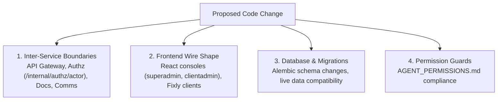

# Evidence-First Investigation & Impact Analysis Guidelines

## Purpose

This document defines the mandatory protocol for investigating bugs, analyzing architecture, and performing code modifications across FBOS backend services.

The primary objective is to eliminate guesswork, prevent regressions, protect API/wire contracts, and ensure that all engineering actions are grounded in verifiable, empirical evidence collected directly from the active environment, codebases, dependency manifests, and authoritative documentation.

---

## 1. Do Not Guess Upfront

Never jump directly into speculative coding or guess how an external library, database constraint, or framework feature works.
Always ground every hypothesis in empirical evidence from the codebase.

### Operational Principles
- **No Speculative Fixes**: Never alter code based on assumptions about runtime state, third-party libraries, or database constraints without confirming the exact behavior first.
- **Evidence-Based Hypotheses**: Before proposing or executing a change, state the hypothesis along with the exact file, line number, log trace, or test output that proves it.
- **Reproduce First**: Whenever possible, establish a reproducible test case, script, or isolated assertion before attempting any modification.

---

## 2. Inspect Code and Dependency Versions First

Before writing, modifying, or reviewing code, always perform a complete environment and dependency audit:

### 1. Identify the Exact Language Version
- Check the runtime Python version in the container, virtual environment, or local environment:
  - Python 3.10 / 3.12 / 3.14.
  - Verify subtle differences across versions (e.g., typing generics, exception groups, async event loop behaviors).

### 2. Identify Exact Library Versions
- Inspect `requirements.txt` / `pyproject.toml` in the active service:
  - `FastAPI>=0.115.0` (lifespan handlers vs. deprecated on_event, router dependencies)
  - `pydantic>=2.8.0` (V2 BaseModel, model_validate, field_validator, ConfigDict vs. V1 class Config)
  - `sqlalchemy[asyncio]>=2.0.0` (`AsyncSession`, `select()`, `execute()`, async streaming, relationship lazy loading semantics)
  - `alembic>=1.13.0` (migration environment, async migration runner, revision branches)
  - `httpx>=0.27.0` (async client lifecycles, connection pooling, timeout configurations)

### 3. Trace Actual Models and Schemas
- **Database Models**: Check SQLAlchemy model definitions in `models/` and review the migration history in `migrations/versions/` to verify real column types, foreign keys, cascades, indexes, and unique constraints.
- **Wire Schemas**: Check Pydantic request and response schemas in `schemas/` to verify field validation, optionality, serialization aliases, and schema contracts.
- **Security & Route Guards**: Trace route dependencies, authentication middlewares, and permission guards enforcing access control.

---

## 3. Read Official & Internal Documentation

Always consult authoritative documentation before writing code:

1. **Review Internal Project Documentation**:
   - Read `CLAUDE.md`, `DEPLOY_AAPANEL.md`, and integration specifications in `docs/`.
   - Review service-specific readmes and architecture decision records (ADRs).
2. **Consult Official Documentation for the Exact Version**:
   - Refer to the documentation matching the active dependency version:
     - Pydantic v2 Migration & Usage Guide
     - FastAPI Lifespan & Dependency Injection Documentation
     - SQLAlchemy 2.0 Async Session Patterns & Relationship Loading
     - Alembic Migration Operations & Offline/Online Run Modes
3. **Adopt Documented Idiomatic Patterns**:
   - When official documentation outlines a recommended or canonical pattern, implement that pattern rather than crafting novel workarounds.

---

## 4. Search External References (If Not in Docs)

If an issue involves an undocumented edge case, complex library interaction, or subtle runtime behavior:

1. **Search Exact Error Strings**:
   - Search the web for the exact error message, exception class, or stack trace output.
2. **Inspect GitHub Issues and Verified Repositories**:
   - Check official repository issue trackers, release notes, and merged pull requests for related upstream bugs, breaking changes, or workarounds.
3. **Verify Compatibility Matrices**:
   - Confirm compatibility between overlapping libraries (e.g., SQLAlchemy + asyncpg driver versions, Pydantic + FastAPI release pairings).

---

## 5. Self-Thinking & Deduction is LAST

Independent reasoning and problem formulation must take place **only after** empirical evidence from code, versions, documentation, and external references has been collected.

### Standard Solutions Over Inventions
- Do not invent custom abstractions, monkey patches, or bespoke workarounds when a standard, documented solution exists.
- Rely on built-in framework features (e.g., FastAPI dependency overrides, SQLAlchemy event listeners, Pydantic validators) rather than creating parallel mechanisms.
- Validate deductive conclusions against the gathered facts. If deductions contradict codebase facts, discard the deduction and re-examine the evidence.

---

## 6. Blast-Radius & Cross-Feature Impact Analysis

Before applying any change to backend code, execute a comprehensive blast-radius evaluation:



### 1. Inter-Service Boundaries
- Will this change break API Gateway routing, header forwarding, or proxy timeouts?
- Does it alter Identity authorization contracts (`/internal/authz/actor`) or impact token parsing?
- Will it disrupt Documents subject checks or Communication event ingestion streams?

### 2. Frontend Wire Shape
- Will changing an endpoint's JSON payload, key names, field types, or HTTP status codes break consuming frontends?
- Assess impact on React frontend consoles (`superadmin`, `clientadmin`) and Fixly mobile/web clients.
- Guarantee backward-compatibility or plan synchronized schema rollouts.

### 3. Database & Migrations
- Does this change require an Alembic schema migration?
- Is the migration safe and non-locking on production tables?
- Does it maintain backward compatibility with existing rows (e.g., nullable additions, default values)?

### 4. Permissions
- Does the route strictly enforce the permissions documented in `AGENT_PERMISSIONS.md`?
- Are role checks and tenant isolation boundaries preserved?

---

## 7. Careful, Surgical Modifications

Execute changes with high precision and strict verification:

### 1. Focused Diffs
- Keep pull requests and diffs tightly focused on the problem at hand.
- Avoid incidental formatting changes, mass renamings, or unrelated refactorings in bugfix branches.

### 2. Defensive Code & Explicit Error Handling
- Write defensive code with appropriate error handling and specific exception catching (see `AGENT_PYTHON.md`).
- Never use bare `except:` clauses or catch untyped generic exceptions without re-raising or logging structured context.

### 3. Isolated Test Verification
- Verify every change with isolated tests before submitting:
  ```bash
  PYTHONPATH=. pytest <service_directory>/tests
  ```
- Add unit or integration regression tests covering the specific defect or architectural boundary being modified.
