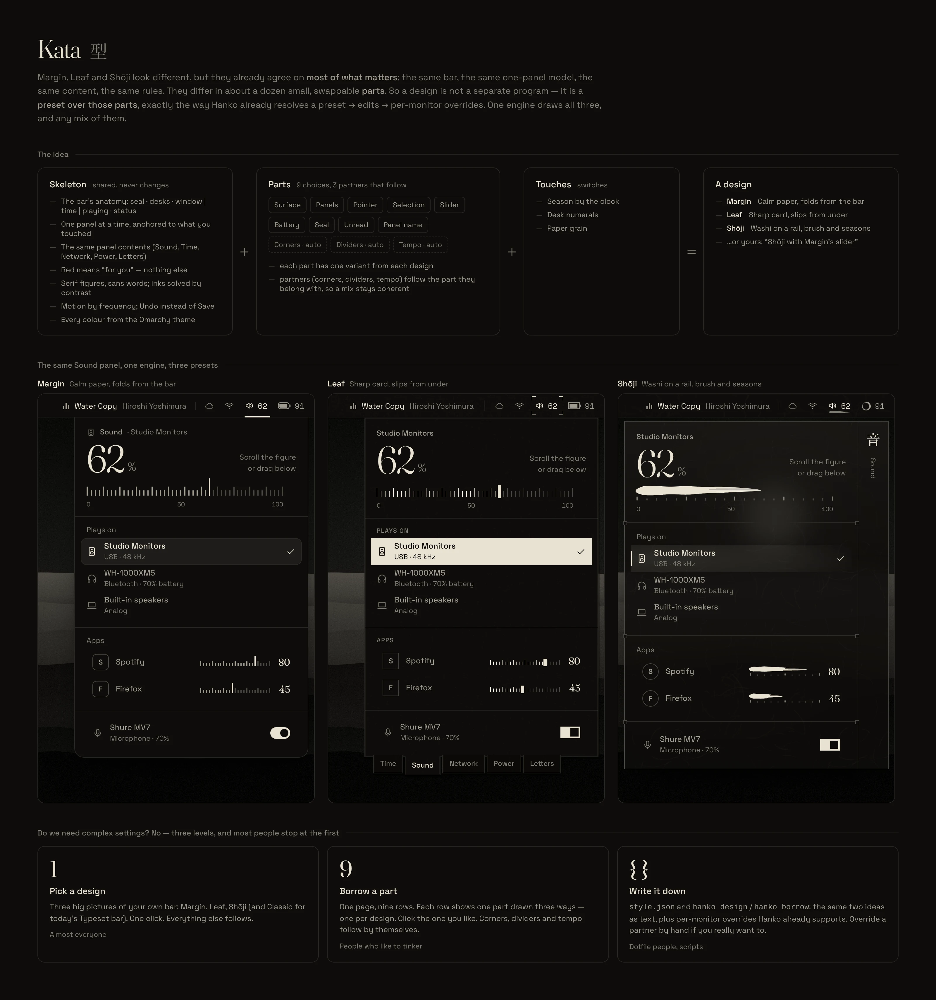
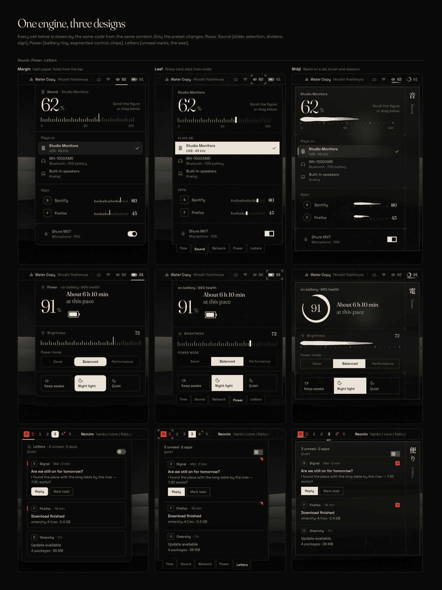
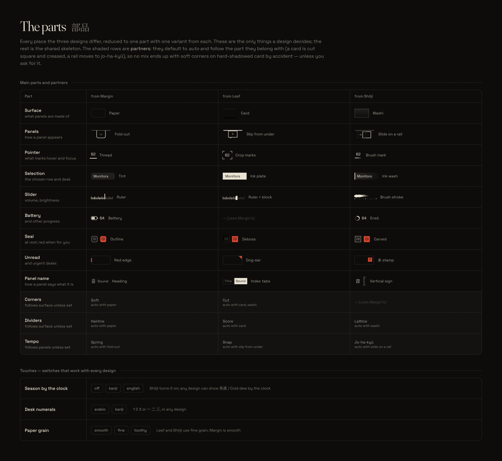
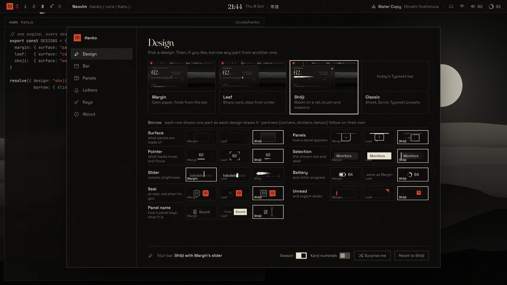
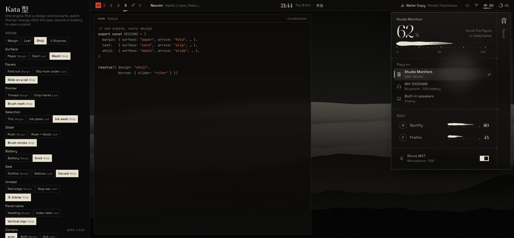
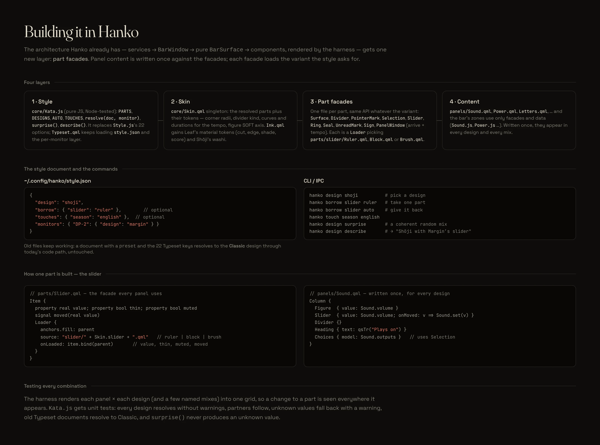

# Hanko · Kata 型 — revision 1: one engine for every design

> **Later:** Margin and Leaf were removed, and with them borrowing parts. Hanko ships two designs, Hanko (the Typeset bar) and Shōji, on the same engine; a style.json that names Margin or Leaf loads as Hanko. This page is kept as the proposal it was. See HANDOFF §9, "Margin and Leaf removed".

**The question:** we have three designs, Margin (`design`), Leaf (`design2`) and Shōji (`design3`). Can Hanko have one uniform system that lets you use any of them, or twist them into your own? And does that need a complicated settings page?

**The answer:** yes to the first, no to the second.

The three designs already agree on most of what matters. They differ in about a dozen small, swappable **parts**. So a design is not a separate program; it is a **preset over those parts**. Hanko's style system already works this way (preset → edits → per-monitor overrides), so this is an evolution, not a rewrite.

Settings stay simple:
- **pick a design**
- **optionally borrow a part**
- **or write it down in `style.json`**



---

## Contents

1. [What the three designs share](#1-what-the-three-designs-share)
2. [Where they differ: the parts](#2-where-they-differ-the-parts)
3. [How a style resolves](#3-how-a-style-resolves)
4. [Settings: three levels, most people stop at one](#4-settings-three-levels-most-people-stop-at-one)
5. [Mixes](#5-mixes)
6. [Building it in Hanko](#6-building-it-in-hanko)
7. [Keeping it simple: rules for the parts list](#7-keeping-it-simple-rules-for-the-parts-list)
8. [Not covered yet, honestly](#8-not-covered-yet-honestly)
9. [Decisions for you](#9-decisions-for-you)
10. [The prototype, the tests and the images](#10-the-prototype-the-tests-and-the-images)

---

## 1. What the three designs share

Read side by side, Margin, Leaf and Shōji agree on all of this, which becomes the **skeleton**. It is written once and never changes between designs:

- **The bar's anatomy:** seal · desks · window | time | now playing · status icons with figures.
- **One panel at a time, anchored under what you touched.** <kbd>Esc</kbd> closes it; Tab walks to the next.
- **The same panel contents:** Sound, Time, Network, Power, Letters, Find, Overview. The data comes from the existing `Sound.js`, `Net.js`, `Power.js`, `Time.js`, `Weather.js`.
- **Red means "for you", nothing else.** Every colour is mixed from the Omarchy theme, and inks are solved by contrast (`InkMath.tier`).
- **Serif figures, sans words.** Numbers are controls (scroll and drag).
- **Motion by frequency.** Frequent actions are instant; Omarchy's reduced motion is respected.
- **Looks plus Undo, no Save.**



Every cell above is drawn by the **same code from the same content**. Only the preset changes.

## 2. Where they differ: the parts



**Nine main parts** (each one a visible choice):

| Part | Margin | Leaf | Shōji |
|---|---|---|---|
| **Surface** — what panels are made of | paper | card (cut edge, hard shadows) | washi (translucent, fibres) |
| **Panels** — how one appears | fold out of the bar | slip from under | slide on a rail (one panel travels) |
| **Pointer** — hover and focus | thread | crop marks | brush mark |
| **Selection** — chosen row and desk | tint | ink plate | ink wash |
| **Slider** | ruler | ruler + block | brush stroke |
| **Battery** (and progress) | battery glyph | (Margin's) | ensō |
| **Seal** at rest (red when for you, in all) | outline | deboss | carved |
| **Unread** and urgent desks | red edge | dog-ear | 未 stamp |
| **Panel name** | heading | index tabs | vertical sign |

**Three partners.** Each defaults to `auto` and follows the part it belongs with, so a mix stays coherent without anyone having to understand why:

| Partner | Follows | auto → |
|---|---|---|
| **Corners** | surface | paper → soft · card, washi → cut |
| **Dividers** | surface | paper → hairline · card → score · washi → lattice |
| **Tempo** | panels | fold → spring · slip → snap · slide → jo-ha-kyū |

**Three touches.** These are plain switches that work with any design:
- **season by the clock:** off / 寒露 / Cold dew
- **desk numerals:** 1 2 3 / 一 二 三
- **paper grain:** smooth / fine / toothy

## 3. How a style resolves

```
style.json ─▶ design preset ─▶ borrowed parts ─▶ partners (auto) ─▶ touches ─▶ monitors[name] ─▶ flat style the bar reads
```

```jsonc
// ~/.config/hanko/style.json
{
  "design": "shoji",
  "borrow":  { "slider": "ruler" },          // optional
  "touches": { "season": "english" },        // optional
  "monitors": { "DP-2": { "design": "margin" } }
}
```

- `resolve()` is pure JavaScript, the same shape as today's `Style.js`. The prototype's version (`prototype/kata.js`) has 10 passing Node tests in `prototype/kata.test.mjs`, which check that:
  - every design resolves cleanly
  - partners follow a borrowed part, and a partner set by hand wins
  - `auto` gives a part back
  - unknown values fall back with a warning
  - the generated name is right ("Shōji with Margin's slider")
  - `surprise()` never produces anything invalid
- **Old files keep working.** A document with a `preset` and the 22 Typeset keys resolves to a fourth design, **Classic**, through today's code path, untouched.

## 4. Settings: three levels, most people stop at one



| Level | What you do | Who |
|---|---|---|
| **1 · Pick a design** | Click one of four pictures of your own bar: Margin, Leaf, Shōji, Classic. | Almost everyone |
| **2 · Borrow a part** | One page, nine rows. Each row shows one part drawn three ways, one per design; click the one you like. Partners follow by themselves. A line at the bottom names your mix, with **Surprise me** and **Reset**. | People who like to tinker |
| **3 · Write it down** | `style.json`, or `hanko design shoji`, `hanko borrow slider ruler`, `hanko borrow slider auto`, `hanko touch season english`, `hanko design surprise`. Per-monitor overrides as today; partners can be overridden here. | Dotfiles, scripts |

So no: this does not need complex settings. Today's Typeset page asks people to choose 22 options by name. Kata asks for **one** choice, then offers **nine visual** ones.

## 5. Mixes

*(The renders of four mixes were removed with Margin and Leaf.)*

The playground (`prototype/playground.html`) has a button for every part. Pick a design, borrow parts, switch theme, and watch the bar and panel change live, with the generated name and the style document beside them.



## 6. Building it in Hanko



Hanko's architecture stays as it is: services → `BarWindow` → pure `BarSurface` → components, rendered by the harness. It gains one layer:

1. **Style:** `core/Kata.js` (pure, Node-tested). It holds `PARTS`, `DESIGNS`, `AUTO`, `TOUCHES`, `resolve(doc, monitor)`, `surprise()` and `describe()`, and replaces `Style.js`'s 22 options. `Typeset.qml` keeps loading `style.json` and the per-monitor layer.
2. **Skin:** a `core/Skin.qml` singleton with the resolved parts and their tokens (radii, divider kind, tempo curves and durations, the figure `SOFT` axis). `Ink.qml` gains Leaf's material tokens (cut, edge, shade, score) and Shōji's washi tile.
3. **Part facades:** one file per part with the same API whatever the variant: `Surface`, `Divider`, `PointerMark`, `Selection`, `Slider`, `Ring`, `Seal`, `UnreadMark`, `Sign`, and `PanelWindow` (arrival + tempo). Each is a `Loader` over `parts/<part>/<variant>.qml`.
4. **Content:** `panels/Sound.qml`, `Power.qml`, `Letters.qml`, … and the bar's zones use only facades and data. Each is written once and appears in every design and every mix.

**Suggested phases** (one commit and one harness render each, as the project already works):

| Phase | Work |
|---|---|
| **R1 · Kata.js** | Port `resolve()` and its tests into `core/` and `tests/unit.mjs`; add Classic as the fallback for old documents; `hanko design / borrow / touch` IPC and CLI. Nothing on screen changes yet. |
| **R2 · Skin and tokens** | `Skin.qml`; Leaf's and Shōji's tokens in `Ink.qml`; the washi and grain tiles generated once per theme into the cache. |
| **R3 · The skeleton with one design** | Build the bar and the one-panel window against facades, with only **one** variant per part: the design you choose as default (see §9). This is most of the work, done once. |
| **R4 · Panels on facades** | Sound, Time, Network, Power and Letters as content files over the facades and the existing `*.js` data. |
| **R5 · The other variants, part by part** | Each part's two other variants are small, separate files (`slider/Ruler.qml`, `Block.qml`, `Brush.qml`; `seal/Outline.qml`, `Deboss.qml`, `Carved.qml`, …). They can land one part at a time, and every one immediately works in every panel. |
| **R6 · Settings › Design** | The four design pictures (live `BarSurface` previews), the nine borrow rows (the swatches are the real part components, small), touches, Surprise, Undo. |
| **R7 · Harness grid** | Every panel × every design × a few named mixes in one render, so a change to a part is seen everywhere it appears. |

## 7. Keeping it simple: rules for the parts list

The risk with a system like this is that it slowly grows back into 22 knobs. Four rules keep it small:

1. **A part exists only where two designs genuinely differ.** If all designs would draw it the same way, it belongs in the skeleton.
2. **The skeleton's rules are not parts.** You can't make red mean "selected", turn off contrast-solved inks, or animate the hundred-a-day actions. Those are what make every mix still feel like Hanko.
3. **Dependent choices are partners, never separate knobs.** Corners, dividers and tempo follow by default; they can be overridden only in `style.json`.
4. **Every variant has the same API.** A content file never asks which design is active. If it needs to, the difference is a missing part, not an `if`.

## 8. Not covered yet, honestly

The prototype models the bar and three panels (Sound, Power, Letters), which covers every part above. Some things in the designs are **whole-screen ideas** rather than small parts. They would become a second wave of parts with the same mechanism:

- **Notifications:** Margin's cards with swipe, Leaf's tickets that tear off, Shōji's rows with 未 seals.
- **Overview:** Margin's miniatures, Leaf's contact sheet, Shōji's framed desks with both numerals.
- **Settings shell:** Margin's window, Leaf's booklet with index tabs, Shōji's 設え with its sign.
- **Small touches:** Margin's crease light, Leaf's hold-to-confirm soak, Shōji's Time panel with the seventy-two seasons. The seasons are already a touch here; the full panel would come with Time.

None of these needs a new mechanism, only more variant files behind the same facades.

## 9. Decisions for you

1. **Which design is the default** for new installs, and so the one built first in R3? Margin is the calmest, Leaf the most distinctive as an object, Shōji the most "Hanko" in spirit.
2. **Does Classic stay?** Keeping today's Typeset bar as a fourth design costs nothing at first, since it uses the existing code path. Later it either gets ported onto the facades or retired.
3. **Should Settings show the borrow page by default**, or behind an "Adjust" button under the design pictures? The mockup shows it open.

## 10. The prototype, the tests and the images

| File | What it is |
|---|---|
| `prototype/kata.js` | The engine: parts, designs, `resolve()`, tokens, the drawn parts (slider, ring, seal, brush, ensō), bar, panels, settings |
| `prototype/kata.css` | One shared markup; each part's variants are attribute selectors (`data-surface`, `data-slider`, …) |
| `prototype/kata.test.mjs` | `node docs/kata/prototype/kata.test.mjs`: 10 resolver tests |
| `prototype/playground.html` | Every part as a button; live desk, generated name and style document |
| `prototype/desk.html` | One desk in any style: `?design=leaf&slider=brush&unread=stamp&season=kanji&panel=inbox&theme=rosepine` (any part or touch name works as a parameter; `panel=sound|power|inbox|settings`) |
| `prototype/sheets.html` | `?page=idea|parts|compare|mixes|build|settings` |
| `prototype/render.sh` | Runs the tests and re-renders every image |

Open `playground.html` with `chromium --allow-file-access-from-files docs/kata/prototype/playground.html`.

| Image | Shows |
|---|---|
| `01-idea` | Skeleton + parts + touches = a design; the same Sound panel in three presets; the three settings levels |
| `02-parts` | Every part and partner with its variants, and the touches |
| `03-one-engine` | Sound, Power and Letters × Margin, Leaf, Shōji |
| `04-margin`, `05-leaf`, `06-shoji` | Each design as a full desk, drawn by the one engine |
| `07-mixes`, `08-mix-light` | Four mixes with their style documents; a light-theme mix |
| `09-settings` | Settings › Design |
| `10-playground` | The playground |
| `11-build` | The four layers in QML, `style.json`, the CLI, how one part (the slider) is built |
