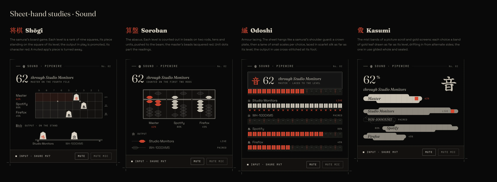

# Sheet hands: research, studies and what was tried

Every bar cell's sheet (Time, Sound, Network, Bluetooth, Power, Display, Inbox) can be drawn in one of six *hands*, chosen per sheet on Settings › Sheets 紙. This file holds the research behind the hands, the four studies that became the craft hands, and the hands that were tried and taken out, so the reasons aren't lost.

## Where it stands

| Hand | State |
|---|---|
| **Ledger 帳** | Shipped, the default. The editorial page: eyebrow and folio, serif title, `//` groups of hairline rows, colophon foot. |
| **Tanzaku 短冊** | Shipped. Each choice a poem slip hung from a rail, right to left, as long as its level; the one in use inked and sealed. |
| **Shōgi 将棋** | Shipped. Each level a piece on a rank of nine squares; choices on the piece stand, the one in play promoted red. |
| **Soroban 算盤** | Shipped. The figures counted in abacus beads; each choice one bead, slid across for the one in use. |
| **Odoshi 縅** | Shipped. A crown plate, then a lame of armour scales per level, laced as far as it goes; the one in use knotted red. |
| **Kasumi 霞** | Shipped. Each level a band of gold-leaf mist, drifting in from alternate sides; the one in use gilded whole and sealed. |
| **Shōji 障子** | Shipped. Not a study: the Shōji design's own panels, made a hand when Shōji was folded into Hanko (HANDOFF §10). Washi on a rail below the bar, a sign down the right edge; it adds a Display panel. |

The user asked for all four studies to be built, so all four shipped as hands of their own, for all seven sheets.

Renders of every sheet in each hand: [Shōgi](images/r2-sheets-shogi.webp), [Soroban](images/r2-sheets-soroban.webp), [Odoshi](images/r2-sheets-odoshi.webp), [Kasumi](images/r2-sheets-kasumi.webp), [Shōji](images/r2-sheets-shoji.webp), the craft hands and Shōji on [light paper](images/r2-sheets-hands-light.webp), and [Settings › Sheets](images/r2-sheets-settings.webp).

What every hand has in common is the design principle the first two set: paper and type, hairlines, a lot of empty room, and red used once, for the thing in use. Anything that reads as an icon grid or a dashboard gauge fails it.

## What was tried and taken out

| Hand | Why it went |
|---|---|
| Dial 盤 | An arc gauge and a tile grid. Rejected as generic ("AI slop"): it is what every dashboard has, and nothing in it is Hanko's. Replaced by Tanzaku; a saved `dial` loads as `tanzaku`. |
| Prose 文 | The state written as a sentence whose words you tap. Rejected; a saved `prose` loads as a ledger. |
| Mon 紋 | A page of a crest book: every choice a kamon (nine-star kuyō crests for levels, bars, lozenge, well frame and rings for the rest), the one in use inked red. Rejected: a grid of round crests read as icons, not as a page. A saved `mon` loads as a ledger, and `sheetStyle:x mon` is refused. |

## Research

The brief was to study old Japan (samurai, rōnin, ninja, the crafts around them) and find something unique, stylish and premium, as games set there do.

**Games.** Sucker Punch kept *Ghost of Tsushima*'s interface as unobtrusive as it could, and let the wind guide the player instead of a HUD; the brushwork lives in the title and chapter cards, while menus stay plain and legible. Creative Assembly spent a year studying woodblock prints and brush painting for *Total War: Shogun 2*'s interface; one reviewer notes that in places the art made units hard to tell apart. The lesson for Hanko: let the craft carry the mood, and never let it cost the reading.

**Samurai.** What a samurai carried showed his allegiance: the crest on his banner (sashimono) and on his clothes; a rōnin was one with no lord's crest left to bear (this fed Mon). His armour was built from small lacquered scales (kozane) laced into rows with silk cords, densely in *kebiki odoshi* or sparsely at intervals in *sugake odoshi*; scarlet lacing (hi-odoshi) marked armour of rank. Shōgi was played across the warrior class; a piece is a pentagon of boxwood with its name brushed on it, and promoted pieces are flipped to a reverse side written in red, usually in a cursive hand.

**Ninja.** The *Bansenshukai* manual and the ninja's hidden inks and coded signs were considered for a "scroll of secrets" hand and set aside: hiding is the opposite of what a sheet has to do, which is show its state at a glance.

**Edo print and paper.** The sumo *banzuke* splits the sheet into East on the right and West on the left around a central column, ranks running outward, rank shown by type size. Woodblock-printed books (wahon) fold each sheet at a central column (hanshin) that carries the title, volume and page, marked by a "fishtail" (gyobi). Gold screens and picture scrolls part their scenes with long, flat bands of stylised mist (suyari-gasumi), laid in gold leaf; Rinpa screens leave much of the gold ground empty as sky.

**Counting.** The soroban counts on rods: a bead counts when it is pushed to the beam, the upper (heaven) bead for five and each of the four lower (earth) beads for one; unit dots on the beam mark the places.

## The four studies

Each was drawn as the Sound sheet only, with the same data as the shipped hands (master 62% through Studio Monitors, Spotify 80%, Firefox 45%, two outputs), in the harness (since deleted, now that they are built; the image above is what they looked like). How each was carried to all seven sheets, and where the built hand differs from its study, follows each one.

### Shōgi 将棋, the board

- A level is a rank of nine squares, and its piece (a pentagonal koma) stands on the square of its level; a click on a square moves it there. The squares it has crossed are washed faintly, red for the master.
- File numbers ９…１ run over the board and rank numerals 一 二 三 down its side, as on a real board, with the hoshi dots.
- The outputs wait on the piece stand (komadai) under the board; the one playing is *promoted*, its character written red, as a promoted piece's reverse is.
- A muted app's piece is turned away, as the other side's pieces point.
- Strength: the most distinctive and the most "samurai"; reads as a slider. Weakness: nine steps; the board is busy beside the empty Ledger and Tanzaku.
- Built: every level with a rank (up to six; time has day, week, month and year), a piece you can set moves on a click or a wheel step, and every choice waits on the stand (Time's week as seven pieces headed 月…日, today promoted). On light paper the pieces stay pale wood with an inked edge, since there "bone" is ink.

### Soroban 算盤, the abacus

- Each level is counted out on two rods, tens and units (62 is the heaven bead and one earth bead, then two earth beads); the master's beads are lacquered red. A spare rod and a unit dot part the readings.
- Beads are drawn as the soroban's double cones (a flattened hexagon with a ridge); a bead that doesn't count rests away from the beam, outlined.
- The outputs are a single bead each, slid across for the one playing.
- Strength: a real instrument, tactile. Weakness: the hardest to read at a glance; the figures under the rods do the reading.
- Built: the frame counts a sheet's own figures (Time: hour, minute, day; Power: charge, capacity, cycles; Inbox: waiting, urgent), with a hundreds rod when a figure needs one; a click on a bead counts to it, as a finger flicks one. Levels the frame doesn't count (networks, devices, letters) are a wire of ten beads each; the week is one wire of seven.

### Odoshi 縅, armour lacing

- The sheet hangs like the shoulder guard (sode) of a great armour: a crown plate (kanmuri-ita) with a fine inner border carries the master, its own lame laced under it.
- Each choice is a lame of small scales with rounded heads, laced densely in scarlet as far as its level (kebiki, hi-odoshi: two braided bands over each scale) and sparsely beyond (sugake: bare scales, their two lacing holes, a pair of cords every third).
- The output in use is laced in full in ink and cross-knotted along its foot (hishinui), as an armour's last plate is.
- Strength: striking, unmistakably samurai. Weakness: the busiest of the four; at small sizes the lacing reads as a pattern before it reads as a level.
- Built: to keep red to "you", ordinary lames are laced in ink and scarlet is kept for the sheet's own reading (the crown's lame) and anything urgent; the choice in use is laced in full with red cross-knots. Time's crown lame has 24 scales, one an hour; a week is one lame of seven runs of scales, today scarlet.

### Kasumi 霞, mist bands (recommended)

- Each choice is a band of gold leaf (the theme's foreground) as long as its level, shaped as a suyari-gasumi: a long flat body with a lip above and below, set in from the ends, rounded off. Faint seams show the squares of leaf laid edge to edge.
- Bands drift in from alternate sides, as mist does across an emaki; the master's band is the fullest gilt and sits under the figure, the sheet's kanji set large at the right like a title slip.
- The output in use is gilded the whole width and carries a small red seal; a muted band is only its dashed outline.
- Strength: the closest to the Ledger and Tanzaku: quiet, paper and gold, red once; reads as a level at once. Weakness: the band shape needs care at small widths (the shortest band is clamped).
- Built: the shortest band is as long as its name needs (up to half the sheet), so names are never cut; unchosen and muted bands are a thin mist rather than a dashed outline, which struck through their names; click or drag along a band to set it. On light paper the bands are sumi mist rather than gold. A week is a row of gold squares (shikishi), today sealed.

## How they are built

The four craft hands draw one plain model per sheet, `core/Hands.js` `model(sheet, feed, now, lib)`: a hero (figure, line, caption, and its level when it has one), levels, choices, quiet lines, buttons and keys. `bar/sheets/HandSheet.qml` is the frame every hand sits in (eyebrow, lines, hint, foot, keys); `ShogiHand`, `SorobanHand`, `OdoshiHand` and `KasumiHand` draw the body, with the parts `Koma`, `Lame`, `MistBand` and `FigureHero`. A new sheet needs one function in `Hands.js`, and all four hands draw it. Every hand sends the same requests as the Ledger.

## Sources

- [Ghost of Tsushima design analysis (Game Developer)](https://gamedeveloper.com/game-platforms/ghost-of-tsushima-design-analysis)
- [Ghost of Tsushima: interview with Nate Fox (Geek Culture)](https://geekculture.co/geek-interview-ghost-of-tsushima-nate-fox)
- [Total War: Shogun 2 review (CGM)](https://www.cgmagonline.com/review/game/total-war-shogun-2/)
- [Kozane: the scales of the samurai armour (Giuseppe Piva)](https://www.giuseppepiva.com/en/news/kozane-the-scales-of-the-samurai-armor/)
- [Armour guide (Kyoto National Museum)](https://www.kyohaku.go.jp/eng/learn/assets/guides/2025_armor_guide_en.pdf)
- [Shogi (Wikipedia)](https://en.wikipedia.org/wiki/Shogi)
- [Soroban (Wikipedia)](https://en.wikipedia.org/wiki/Soroban)
- [Anatomy of a banzuke (Tachiai)](https://tachiai.org/2025/10/19/anatomy-of-a-banzuke)
- [Wahon (Samurai Archives)](https://samurai-archives.com/wiki/Wahon)
- [A Rinpa-style gold-leaf byōbu (Chairish)](https://www.chairish.com/product/36413231/large-japanese-four-panel-byobu-folding-screen-in-the-rinpa-style-with-gold-leaf)
