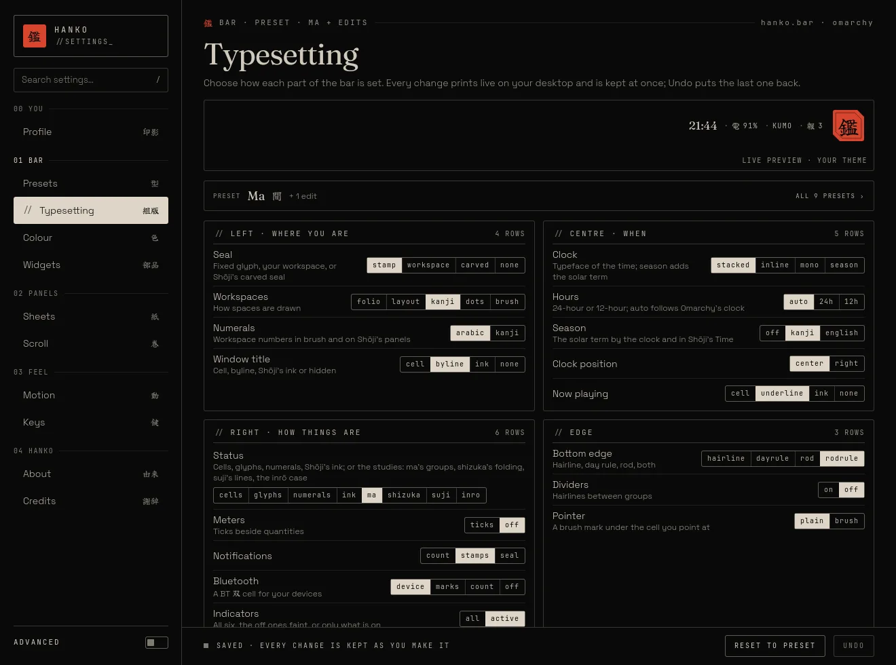
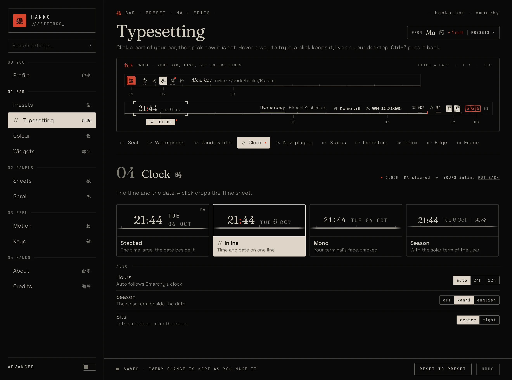
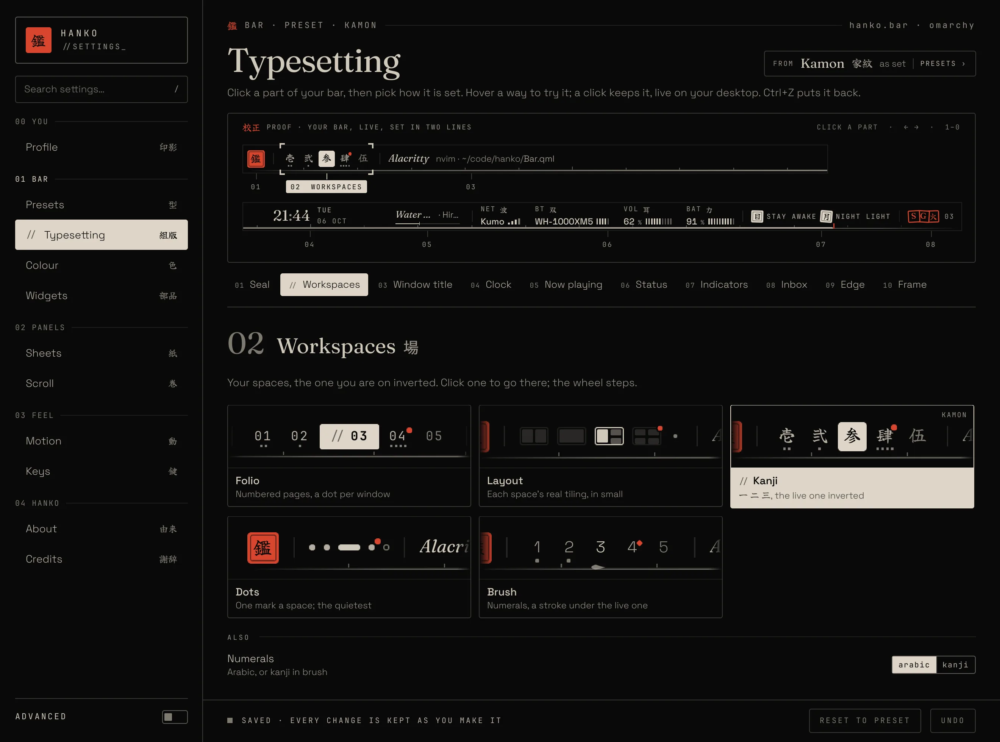
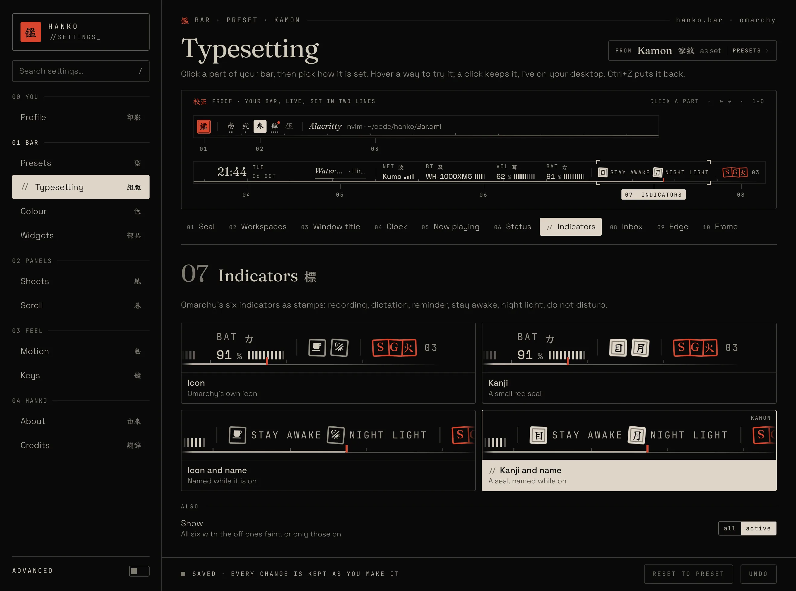
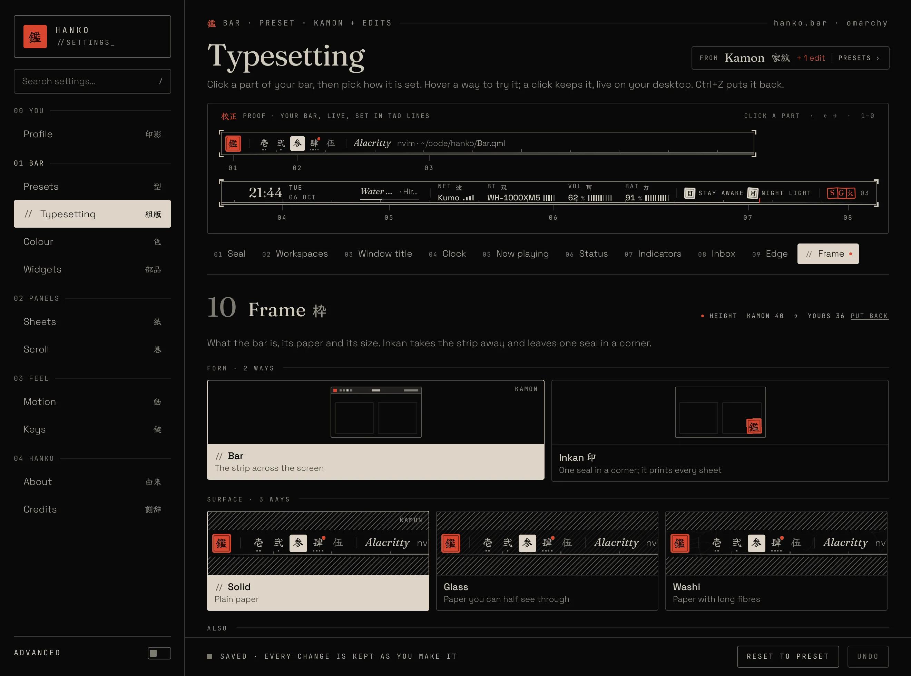
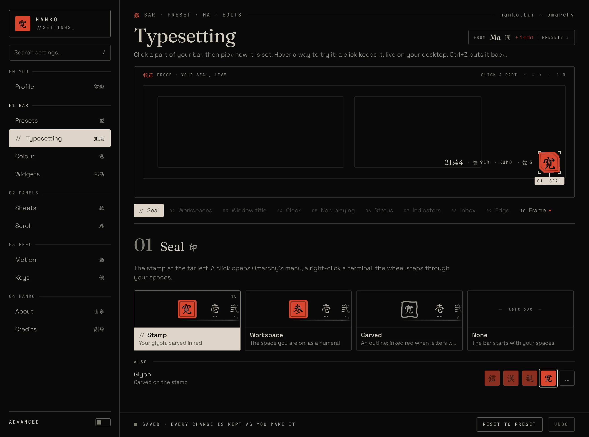
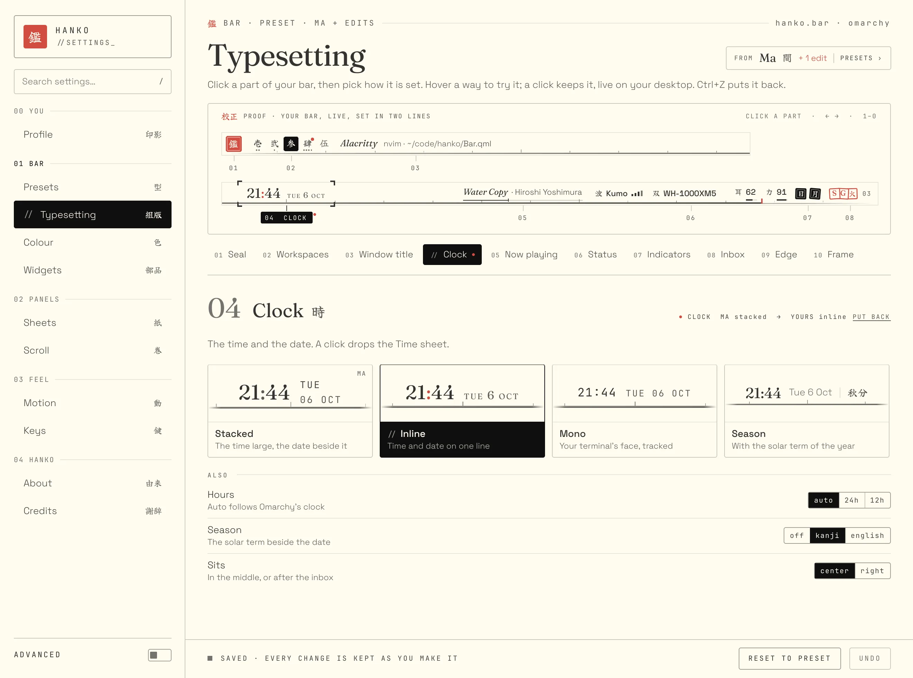
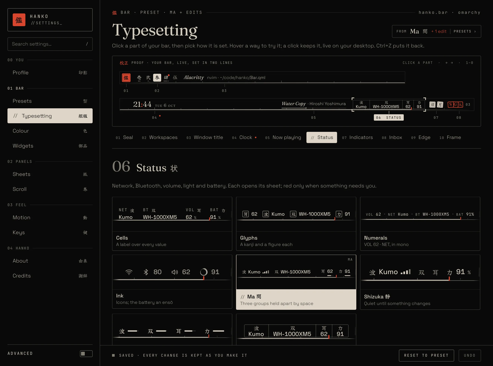
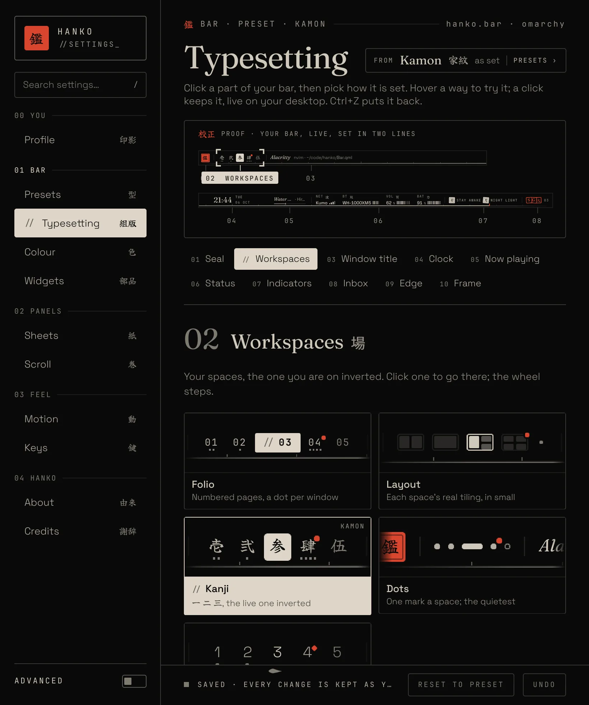

# Kōsei 校正 · Typesetting as a proof

Asked for: "in the settings app … all are just crumbled in Typesetting … take your time, think, and redesign it properly. Research how people create this kind of experience, then come up with something unique and premium, not generic AI slop."

## What was wrong

Typesetting held 33 settings as segmented controls in six cards. Every choice was a word (`stamp · workspace · carved`, `cells · glyphs · … · shizuka · suji · inro`), so you had to know the vocabulary and picture the result yourself. Eight-option rows wrapped under their names while four-option rows sat beside them, so the cards had ragged heights and no rhythm. The live preview at the top was a long, thin strip; under Inkan it was an almost empty box. The page set out the code's model (keys and values), not the thing you were editing.

## What the research says

- **Configurators put the object in the middle.** Car and furniture configurators and game character creators show the thing large; you pick a part of it, and the choices for that part appear beside it. Guides on configurator UX agree on starting with simple choices, showing every option as a tile with a short description, and keeping undo easy ([prototypr](https://blog.prototypr.io/21-best-practices-for-e-commerce-configurator-s-690668efe754), [Cloudflight](https://www.cloudflight.io/en/blog/best-product-configurators-ecommerce/), [The Digital Bunch](https://www.thedigitalbunch.com/blog/how-to-uxui-design-a-3d-configurator-that-makes-sense)).
- **HUD editors let you click the element itself.** FFXIV's HUD Layout outlines the selected element and lets you pick it on screen or from a list ([official guide](https://na.finalfantasyxiv.com/uiguide/know/know-hud/hud-layout.html)); WoW's Edit Mode outlines every movable frame, and a single click opens that frame's own options. The pattern: select on the object, a list as a second way in, a panel for the details.
- **Pictures beat words for looks, but not on their own.** Google's study of result thumbnails found that thumbnails add information the text lacks, while thumbnails *without* text did worse than text alone; large thumbnails with titles did best ([Google Research](https://research.google.com/pubs/archive/36251.pdf)). Segmented controls stay good for 2–5 short, abstract choices ([Primer](https://primer.style/components/segmented-control), [Apple HIG](https://developer.apple.com/design/human-interface-guidelines/segmented-controls)).

So: pick on the bar itself; show every *look* as a picture of that look with a name and a line under it; keep the few abstract choices (hours, meters, position…) as short segmented rows.

## The idea: a printer's proof

Hanko's settings page is already called Typesetting 組版. A compositor checks type by pulling a **proof** (校正刷り), with corrections marked in the margin. So the page becomes one:

1. **The galley.** Your bar, live, laid out at your screen's real width (so nothing folds away as it would on a narrow strip), **set in two lines** the way a galley runs a long line over: the left zone, then from just before the clock to the right end, each at close to its real size. Every part is numbered in the margin under it (01 Seal … 08 Inbox), joined by a leader. Hover a part and it is bracketed; click it and its case opens. The bar's foot is 09 Edge, the paper around it 10 Frame. Under Inkan the galley is a small screen with your seal in its corner and its reading beside it.
2. **The index.** The ten parts by number and name, for when a part is hard to hit or not drawn (Now playing with nothing playing). An edited part carries a red dot: red means *you*.
3. **The case** (活字ケース, the compositor's type case) for the open part: its number, name and kanji, one plain line on what it does and what clicks on it do, then a **specimen** for every way it can be set. A specimen is the real bar set that way with your data, cropped to the part: not an icon, not a drawing. The one in use is inverted with a `//` lead (the design's emphasis rule); the preset's own way says so in the corner. **Hover tries it on the galley; a click keeps it.** Under the specimens, **Also**: the few choices that are words (Hours, Season, Sits; Meters, Bluetooth; Dividers, Pointer; Height, Type, Float, Position, Grain, Corner), and the seal glyph as four small red stones.
4. **What you changed**, beside the heading: `CLOCK  MA stacked → YOURS inline  PUT BACK`, one click to put back the preset's value.

How panels open (sheets or scroll, sides, guides, overview) left Typesetting for the Scroll 巻 page, which already held the scroll's dividers and end leaf.

Keys: `←` `→` walk the parts, `1`–`9` and `0` open one; search lights only the parts that match (in the galley, the index and the case), and says where to look when nothing on the bar matches.

| | |
|---|---|
|  |  |
| 06 Status: eight right sides, each the real thing | 04 Clock, with what you changed and Put back |
|  |  |
| 02 Workspaces | 07 Indicators |
|  |  |
| 10 Frame: Form as screens, Surface over a hatch so glass shows | Under Inkan: the seal in its corner |
|  |  |
| A light theme | Hovering Inrō tries it on the galley |

## The rules it keeps

One paper, four inks, one red (red only for your edits and the seal); emphasis by inversion; hairlines, no shadows; Fraunces for the titles, Space Grotesk for names, the mono face for marks and labels. Every change is still kept at once with Undo; there is no Save.

## Code

- `core/Settings.js`: `PROOF` (the ten parts: number, name, kanji, line, `cast` settings drawn as specimens, `also` settings as words, `bar`), `WAYS` / `wayOf` (a name and a line for every way of every cast setting), `ALSO` / `alsoOf`, `proofEdits`, `proofMatches`, `proofStep`, `proofPartOf`, `PANELS_CARD`, `SAMPLE_INDICATORS` (two lit stamps when none is on, so the part has a face). Tests in `tests/unit.mjs` check that every setting has exactly one home.
- `bar/BarSurface.qml`: `partRect(part)` and `layoutTick`.
- `bar/settings/Galley.qml`, `Specimen.qml`, `TypeCase.qml`. Both the galley and the specimens measure the bar 30 ms after its layout changes: a Row places its children in a later pass, so a binding over their positions can latch onto a half-laid-out row.
- `bar/settings/SettingsPage.qml`: `part`, `trial`, `proofStyle`, `litParts`, `partShown`, `editedParts`, `proofData`, `stepPart`, `pickPartAt`; the preset chip beside the title.
- `bar/SettingsWindow.qml`: the keys, and `screenWidth` and `indicators` in the bar data.
- Harness: `tests/harness/params/proof*.json` (scene `Settings`, `settings.part`, `settings.trial`).

## Part two: the whole window

Asked for next: "just like you redesigned Typesetting, redesign all the other sections too; make more pages if needed; you have full control of the whole settings flow and layout."

The same rule on every page: **the thing itself first, pictures of its choices second, words last.** Each page borrows an object from Japanese print and craft that does that page's job.

| Page | Was | Becomes | Why (research) |
|---|---|---|---|
| Shell | 11 pages in 5 groups, an Advanced switch | Four groups, Typesetting first; key hints in the rail's foot; the action bar names the last change | Undo is only trusted when you can see what it will undo |
| Presets 型 | Nine bars in a long list, each a thin strip | **Pattern book** (the dyers' stencil sample books, *komon-chō*, used to choose patterns since the early 1800s): the pattern set as your proof, with only what it would change from yours, then Use | Trim-compare tools lead with the differences, not the full spec ([J.D. Power](https://www.jdpower.com/business/chrome-compare/)) |
| Widgets → **Parts 部品** | Fourteen shown/hidden toggles | **Sorts tray**: every part as a real specimen in bar order; set-aside ones ghosted; Show all | Bartender's own support notes users read its hide toggle backwards ([Bartender](https://macbartender.com/b3_knowledge/items-not-staying-hidden)); one clear state per item, and a way back |
| Colour 色 | An empty page | Your theme's paper, inks and red, measured; every Omarchy theme as a specimen to switch to | — |
| Advanced → **Screens 画面** | A switch revealing a dense grid | Your monitors drawn to scale; click one to see and set what differs | macOS arranges displays as tiles to scale, the picked one highlighted ([guide](https://www.techrepublic.com/article/how-to-configure-second-display-mac/)) |
| Sheets 紙 · Scroll 巻 · **Overview 一覧** | Text cards, segmented rows | The proof pattern: the sheet drawn large, each hand as a picture of *that* sheet | Same as Typesetting |
| Motion 動 | A switch and a table of numbers | **Timesheet** (タイムシート, the animator's exposure sheet): every motion as a bar on a ms ruler; hover plays it | Japanese timesheets lay out each action in its own column against frames ([TVPaint](https://doc.tvpaint.com/docs/timesheet/timesheet-overview), [Wikipedia](https://en.wikipedia.org/wiki/Exposure_sheet)) |
| Keys 鍵 | A paragraph | **Keymap**: keycaps by context; hover a key to read it | Keyboard maps that light the keys a shortcut uses ([Fluid Project](https://fluidproject.atlassian.net/wiki/spaces/fluid/pages/11633699/KBS+Concept+2)); keycap labels over plain text |

Built in steps, each its own commit: R1 the shell and Screens, R2 Presets, R3 Parts, R4 Colour, R5 Sheets, Scroll and Overview, R6 Motion and Keys.
